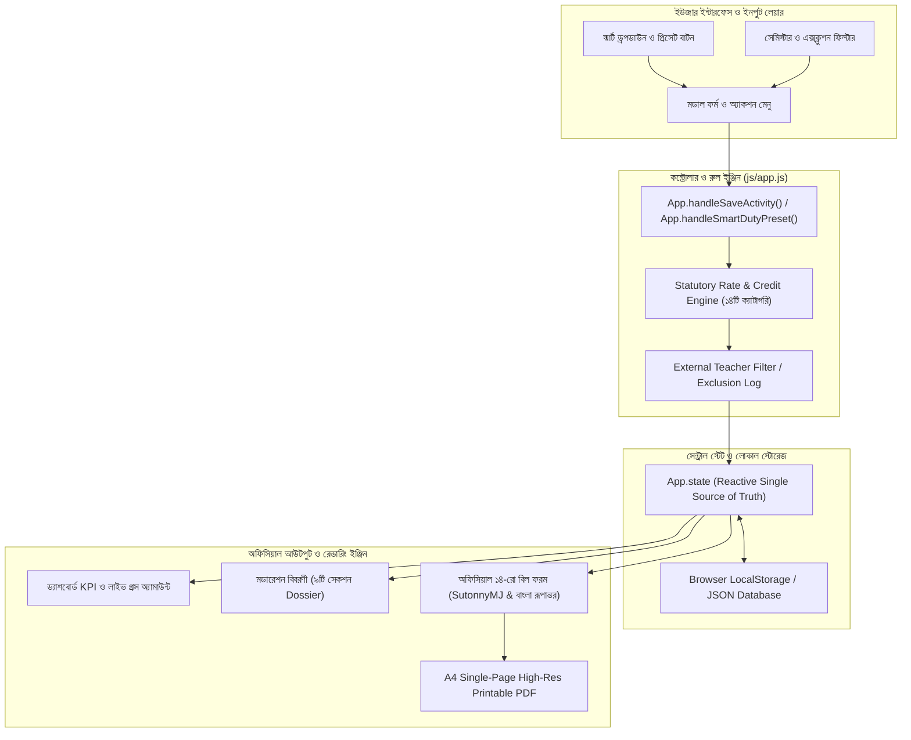

# MBSTU ICT Examination & Semester Bill Management System
## 🎓 Comprehensive Technical Documentation, Architecture, Viva Defense Guide & System Analysis

> **Academic Project Submission:** Software Engineering Capstone Project / Course Project  
> **Sole Author & Developer:** Md Tahmid Hasib Antor (Student ID: **IT24055**)  
> **Department:** Department of Information and Communication Technology (ICT)  
> **Institution:** Mawlana Bhashani Science and Technology University (MBSTU), Santosh, Tangail-1902  
> **Live System:** [https://antor1112225.github.io/MBSTU-ICT-Examination-and-Bill-Management-System/](https://antor1112225.github.io/MBSTU-ICT-Examination-and-Bill-Management-System/)  
> **GitHub Repository:** [https://github.com/antor1112225/MBSTU-ICT-Examination-and-Bill-Management-System](https://github.com/antor1112225/MBSTU-ICT-Examination-and-Bill-Management-System)

---

## 📑 সূচিপত্র (Table of Contents)
1. [Antigravity IDE-তে প্রজেক্ট সেটআপ ও ফাইল স্ট্রাকচার](#1-antigravity-ide-তে-প্রজেক্ট-সেটআপ-ও-ফাইল-স্ট্রাকচার)
2. [সিস্টেম কীভাবে কাজ করছে: আর্কিটেকচার ও ডেটা ফ্লো](#2-সিস্টেম-কীভাবে-কাজ-করছে-আর্কিটেকচার-ও-ডেটা-ফ্লো)
3. [মূল কোড মডিউল ও ক্যালকুলেশন ইঞ্জিন বিশ্লেষণ](#3-মূল-কোড-মডিউল-ও-ক্যালকুলেশন-ইঞ্জিন-বিশ্লেষণ)
4. [প্রজেক্টের কাজ (Core Purpose & Objective)](#4-প্রজেক্টের-কাজ-core-purpose--objective)
5. [ফিচারসমূহ (Comprehensive Features)](#5-ফিচারসমূহ-comprehensive-features)
6. [সুবিধাসমূহ / উপযোগিতা (Real-world Benefits)](#6-সুবিধাসমূহ--উপযোগিতা-real-world-benefits)
7. [সীমাবদ্ধতা (Current Limitations)](#7-সীমাবদ্ধতা-current-limitations)
8. [ভবিষ্যৎ উন্নয়ন পরিকল্পনা (Future Enhancements)](#8-ভবিষ্যৎ-উন্নয়ন-পরিকল্পনা-future-enhancements)
9. [ডিফেন্স ও ভাইভা সম্ভাব্য প্রশ্নোত্তর (Expected Viva Questions & Model Answers)](#9-ডিফেন্স-ও-ভাইভা-সম্ভাব্য-প্রশ্নোত্তর-expected-viva-questions--model-answers)

---

## 1. Antigravity IDE-তে প্রজেক্ট সেটআপ ও ফাইল স্ট্রাকচার

### ক. প্রজেক্টের লোকেশন ও ওপেন করার নিয়ম
প্রজেক্টের সম্পূর্ণ কোডবেস লোকাল ড্রাইভে রয়েছে:
```
C:\Users\Antor\.gemini\antigravity\scratch\MBSTU_ICT_EXAM_BILL_SYSTEM
```

**Antigravity IDE-তে ওপেন করার ধাপ:**
1. Antigravity IDE-এর মেনু থেকে **File** > **Open Folder...** সিলেক্ট করুন।
2. পাথ হিসেবে উপরের ফোল্ডারটি (`MBSTU_ICT_EXAM_BILL_SYSTEM`) ব্রাউজ করে **Select Folder** চাপুন।
3. এটি ওপেন হলে প্রজেক্টের সম্পূর্ণ ফাইল ট্রি IDE-এর লেফট এক্সপ্লোরারে চলে আসবে।
4. কোনো ধরনের Node.js ডিপেন্ডেন্সি ইনস্টলেশন বা জটিল ডাটাবেস সার্ভার কনফিগারেশন ছাড়াই সরাসরি [index.html](file:///C:/Users/Antor/.gemini/antigravity/scratch/MBSTU_ICT_EXAM_BILL_SYSTEM/index.html) ডাবল-ক্লিক করে বা ব্রাউজারে রান করলেই সম্পূর্ণ সিস্টেম লাইভ কাজ করবে।

### খ. ফাইল ডিরেক্টরি কাঠামো
```
MBSTU_ICT_EXAM_BILL_SYSTEM/
│
├── index.html                   # কোর অ্যাপ্লিকেশন লেআউট (১০টি ট্যাব, ১৮টি মডাল, অফিসিয়াল বিল ফরম ও মডারেশন শীট)
├── poster.html                  # ৪৮" × ৩৬" একাডেমিক পোস্টার প্রেজেন্টেশন ব্যানার
├── README.md                    # প্রজেক্ট ওভেনভিউ, লাইভ লিঙ্ক ও অথর ইনফরমেশন
├── PROJECT_PROPOSAL.md          # একাডেমিক প্রপোজাল ও ৬টি সফটওয়্যার ইঞ্জিনিয়ারিং ডায়াগ্রাম
├── THESIS_BOOK_REPORT.md        # কমপ্লিট আন্ডারগ্র্যাজুয়েট থিসিস বুক ও ল্যাব রিপোর্ট
│
├── css/
│   └── style.css                # SutonnyMJ টাইপোগ্রাফি, রেসপন্সিভ গ্রিড, ড্রপডাউন ও প্রিন্ট লেআউট
│
├── js/
│   └── app.js                   # সম্পূর্ণ স্টেট ম্যানেজমেন্ট, ১৪টি সংবিধিবদ্ধ রুলস, ক্যালকুলেশন ইঞ্জিন ও এক্সপোর্ট লজিক
│
├── assets/
│   └── mbstu_logo.png           # বিশ্ববিদ্যালয়ের অফিসিয়াল লোগো ও এম্ব্লেম
│
└── scratch/                     # অটোমেশন স্ক্রিপ্ট, টেস্ট ও গিটহাব সিনক্রোনাইজার
```

---

## 2. সিস্টেম কীভাবে কাজ করছে: আর্কিটেকচার ও ডেটা ফ্লো

সিস্টেমটি একটি আধুনিক **ক্লায়েন্ট-সাইড সিঙ্গেল পেজ অ্যাপ্লিকেশন (SPA)** যা **Event-Driven MVC (Model-View-Controller)** প্যাটার্ন অনুসরণ করে।



### ডেটা ফ্লো প্রক্রিয়া:
1. **ইনপুট রিসিভিং:** ব্যবহারকারী যখন ড্রপডাউন থেকে কোর্স, সেমিস্টার এবং ১-ক্লিক ডিউটি সিলেক্ট করেন, কন্ট্রোলার স্বয়ংক্রিয়ভাবে ক্রেডিট লোড করে।
2. **রুল প্রসেসিং:** কোর্সের ক্রেডিটের ওপর ভিত্তি করে প্রশ্নপত্র ও ক্লাস টেস্টের সংবিধিবদ্ধ কাউন্ট নির্ধারিত হয়।
3. **এক্সক্লুশন হ্যান্ডলিং:** শিক্ষক যদি এক্সটার্নাল হন, তার পেমেন্ট আইসিটি ডিপার্টমেন্টের অভ্যন্তরীণ বাজেটে যুক্ত না হয়ে এক্সক্লুশন লগ ও মডারেশন বিবরণীতে পৃথকভাবে ট্র্যাক হয়।
4. **অফিসিয়াল রেন্ডারিং:** স্টেট আপডেটের সাথে সাথে SutonnyMJ ফন্ট এবং বাংলা সংখ্যা/কথায় কনভার্ট হয়ে অফিসিয়াল ১৪-রো বিলে প্রতিফলিত হয়।

---

## 3. মূল কোড মডিউল ও ক্যালকুলেশন ইঞ্জিন বিশ্লেষণ

### ক. ১৪টি সংবিধিবদ্ধ ক্যাটাগরি ক্যালকুলেশন ইঞ্জিন
বিশ্ববিদ্যালয়ের নিয়ম অনুযায়ী ক্রেডিট এবং উত্তরপত্রের পরিমাণের ওপর ভিত্তি করে ডাইনামিক রেট ক্যালকুলেট হয়:

```javascript
// js/app.js: ক্যালকুলেশন রুল ইঞ্জিন
calculateStatutoryDutyAmount(dutyType, credit, studentCount, durationHours) {
    switch (dutyType) {
        case 'question_setting':
            // ৩.০০ ক্রেডিট বা তার বেশি হলে ৪০০০/- টাকা (হাফ পার্ট ২০০০/- টাকা)
            // ২.০০ ক্রেডিট হলে ২৪০০/- টাকা (হাফ পার্ট ১২০০/- টাকা)
            return credit >= 3.0 ? 4000 : (credit >= 2.0 ? 2400 : 1600);

        case 'moderation_board':
            // ৪ জন সদস্যের জন্য প্রতি কোর্সে ১৬০০/- টাকা
            return 1600;

        case 'script_evaluation':
            // প্রতি উত্তরপত্র ১২০/- টাকা (সর্বনিম্ন ১০০০/- টাকা)
            const scriptTotal = studentCount * 120;
            return Math.max(scriptTotal, 1000);

        case 'class_test':
            // ৩.০০ ক্রেডিটে ৪টি, ২.০০ ক্রেডিটে ৩টি, ১.০০ ক্রেডিটে ২টি সিটি (প্রতি সিটি ১২০০/- টাকা)
            const ctCount = credit >= 3.0 ? 4 : (credit >= 2.0 ? 3 : 2);
            return ctCount * 1200;

        case 'lab_exam':
            // ল্যাব এক্সাম ডিউটি প্রতি পরীক্ষা ১০০০/- টাকা
            return 1000;

        case 'tabulation':
            // ট্যাবুলেশন প্রতি শিক্ষার্থী ৭৫/- টাকা
            return studentCount * 75;

        default:
            return 0;
    }
}
```

### খ. বাংলা সংখ্যা ও SutonnyMJ টাইপোগ্রাফি ইঞ্জিন
অফিসিয়াল লেটারহেড ও বিলে সংখ্যা এবং টাকা কথায় বাংলা লিপিতে উপস্থাপনের জন্য পিওর জেএস অ্যালগরিদম ব্যবহৃত হয়েছে:

```javascript
// js/app.js: সংখ্যা থেকে বাংলা অংকে রূপান্তর
convertToBengaliNumerals(num) {
    if (num === null || num === undefined) return '০';
    const bnDigits = ['০', '১', '২', '৩', '৪', '৫', '৬', '৭', '৮', '৯'];
    return num.toString().replace(/[0-9]/g, d => bnDigits[parseInt(d, 10)]);
}
```

### গ. ড্রপডাউন ও অ্যাকশন কন্ট্রোল মেকানিজম
ড্রপডাউন যাতে কোনো কার্ডের ভেতরে কেটে না যায় (`overflow: visible`) এবং ইভেন্ট প্রোপাগেশন থামিয়ে ব্রাউজারে নিখুঁতভাবে রেন্ডার হয়:

```javascript
// js/app.js: ড্রপডাউন টগল লজিক
toggleDropdown(dropdownId, event) {
    if (event && typeof event.stopPropagation === 'function') {
        event.stopPropagation();
    }
    const el = document.getElementById(dropdownId);
    if (!el) return;
    const isShown = el.classList.contains('show');
    this.closeAllDropdowns();
    if (!isShown) {
        el.classList.add('show');
    }
}
```

---

## 4. প্রজেক্টের কাজ (Core Purpose & Objective)

### কাজ ও মূল উদ্দেশ্য:
1. **কাগজবিহীন ডিজিটাল বিলিং:** মাভাবিপ্রবির আইসিটি বিভাগের সেমিস্টার ফাইনাল পরীক্ষার যাবতীয় পারিশ্রমিক ও বিল প্রস্তুত করার ধীরগতির হস্তলিখিত প্রক্রিয়াকে শতভাগ স্বয়ংক্রিয় করা।
2. **হিউম্যান এরর নির্মূল:** প্রশ্নপত্র প্রণয়ন, পরিমার্জন, খাতা দেখা, ল্যাব পরীক্ষা এবং ক্লাস টেস্টের ম্যানুয়াল গণনার ভুল বন্ধ করা।
3. **অডিট ও অনুমোদন স্বচ্ছতা:** বিভাগীয় চেয়ারম্যান, পরীক্ষা নিয়ন্ত্রক এবং অর্থ ও হিসাব দপ্তরের জন্য তাৎক্ষণিক অডিট লগ এবং সংবিধিবদ্ধ মডারেশন বিবরণী তৈরি করা।
4. **১:১ অফিসিয়াল ফর্ম রিপ্লিকা:** বিশ্ববিদ্যালয়ের অনুমোদিত নীল-বর্ডারের ১৪-কলামের বিল ফরমের অবিকল লেআউটে তাৎক্ষণিক প্রিন্টেবল স্লিপ প্রদান করা।

---

## 5. ফিচারসমূহ (Comprehensive Features)

| ফিচার ক্যাটাগরি | বিস্তারিত সুবিধাসমূহ |
| :--- | :--- |
| **১. স্মার্ট ১-ক্লিক ডিউটি প্রিসেট** | প্রশ্নপত্র প্রণয়ন, খাতা মূল্যায়ন, স্ক্রুটিনি বা ট্যাবুলেশন ড্রপডাউন থেকে সিলেক্ট করলেই রেট, ইউনিট ও সূত্র স্বয়ংক্রিয়ভাবে বসে যায়। |
| **২. ১৪টি সংবিধিবদ্ধ ক্যাটাগরি** | বিশ্ববিদ্যালয় সিন্ডিকেট ও একাডেমিক কাউন্সিল অনুমোদিত ১ থেকে ১৪তম প্রতিটি ডিউটি টাইপ কোডে সংরক্ষিত। |
| **৩. ক্রেডিট-ভিত্তিক ক্লাস টেস্ট রুল** | ৩.০০ বা তদূর্ধ্ব ক্রেডিটে ৪টি সিটি, ২.০০ ক্রেডিটে ৩টি সিটি এবং ১.০০ ক্রেডিটে ২টি সিটির স্বয়ংক্রিয় হিসাব। |
| **৪. এক্সটার্নাল টিচার এক্সক্লুশন লগ** | রুয়েট, ডুয়েট, জাবি বা হাবিপ্রবির বহিঃস্থ শিক্ষকদের পারিশ্রমিক অভ্যন্তরীণ শিক্ষকদের বাজেট থেকে পৃথক করে স্বয়ংক্রিয় এক্সক্লুশন লগ তৈরি। |
| **৫. কুরিয়ার / ট্রানজিট ভাউচার (Row 14)** | প্রশ্নপত্র ও উত্তরপত্র প্রেরণের ডাক/ক্যারিয়ার খরচ ভাউচার নং সহ ১৪ নং সারিতে স্বয়ংক্রিয়ভাবে যোগ হওয়া। |
| **৬. লাইভ ফর্মুলা ক্যালকুলেশন প্রিভিউ** | ইনপুট দেওয়ার সময়েই স্ক্রিনে সরাসরি দেখা যায় কোন সূত্রে মোট টাকা হিসাব হচ্ছে। |
| **৭. SutonnyMJ ও বাংলা কথায় রূপান্তর** | টাকার অঙ্ক শতভাগ সুতন্বীএমজে ফন্টে বাংলা সংখ্যা এবং কথায় (In Words) রূপান্তর। |
| **৮. ৫০ টাকার রাজস্ব স্ট্যাম্প বক্স** | ৫০০ টাকার বেশি বিলে বিশ্ববিদ্যালয়ের অডিট নিয়ম অনুযায়ী ৫০ টাকার রেভিনিউ স্ট্যাম্পের নির্ধারিত বক্স। |
| **৯. সম্পূর্ণ অফলাইন ও জিরো ডিপেন্ডেন্সি** | ইন্টারনেট ছাড়া কেবল ব্রাউজারে চলে; ডাটাবেস ব্যাকআপ ও রিস্টোর সম্পূর্ণ JSON ফাইল আকারে সংরক্ষিত। |
| **১০. রেসপন্সিভ মোবাইল ইন্টারফেস** | ডেস্কটপ, ল্যাপটপ, ট্যাবলেট বা স্মার্টফোন—যেকোনো ডিভাইসে অনায়াসে ব্যবহার উপযোগী। |

---

## 6. সুবিধাসমূহ / উপযোগিতা (Real-world Benefits)

1. **সময় সাশ্রয় (Time Efficiency):** পূর্বে একটি সেমিস্টারের সকল শিক্ষকের বিল হাতে লিখতে ও হিসাব মেলাতে ২ থেকে ৩ সপ্তাহ সময় লাগত; বর্তমানে মাত্র **২ মিনিটে** সমগ্র সেমিস্টারের বিল ও বিবরণী প্রস্তুত হয়।
2. **শতভাগ নির্ভুল গাণিতিক হিসাব (Zero Mathematical Error):** জাভাস্ক্রিপ্ট রুল ইঞ্জিনের কারণে ভুল রেট প্রয়োগ বা যোগের ভুল হওয়ার কোনো অবকাশ নেই।
3. **আর্থিক অডিট জবাবদিহিতা (Audit Trail & Transparency):** প্রতিটি বিলের সাথে সংশ্লিষ্ট কোর্স কোড, সেমিস্টার, ক্রেডিট ও তারিখ স্বয়ংক্রিয়ভাবে সংরক্ষিত থাকে।
4. **জিরো সার্ভার খরচ (Zero Operational Cost):** কোনো পেইড ক্লাউড সার্ভার বা ডাটাবেস হোস্টিং ফি প্রয়োজন হয় না।
5. **কাগজ অপচয় হ্রাস:** স্ক্রিনে ফাইনাল চেক করার পর কেবল অনুমোদিত বিলটি প্রিন্ট করা যায়, ফলে ভুল বিল রিপ্রিন্ট করার কাগজ অপচয় রোধ হয়।

---

## 7. সীমাবদ্ধতা (Current Limitations)

1. **ব্রাউজার লোকাল স্টোরেজ নির্ভরতা:** ডাটা ব্যবহারকারীর লোকাল ব্রাউজারের `localStorage`-এ জমা থাকে। ব্রাউজার ক্যাশ ও ডাটা সম্পূর্ণ মুছে ফেললে ব্যাকআপ ফাইল থেকে রিস্টোর করতে হয়।
2. **একক ব্যবহারকারী মোড (Single-user Local Environment):** একাধিক শিক্ষক একই সাথে বিভিন্ন কম্পিউটার থেকে রিয়েল-টাইমে ডাটা এন্ট্রি দিতে পারেন না (কেননা সেন্ট্রাল ক্লাউড ডাটাবেজ এখনও সংযুক্ত হয়নি)।
3. **ডিজিটাল ক্রিপ্টোগ্রাফিক স্বাক্ষরের অনুপস্থিতি:** প্রিন্ট করার পর বিভাগীয় প্রধান ও শিক্ষকদের সনাতন কলমে স্বাক্ষর করতে হয়; পিকেআই (PKI) ভিত্তিক ডিজিটাল সিগনেচার এখনও যুক্ত করা হয়নি।

---

## 8. ভবিষ্যৎ উন্নয়ন পরিকল্পনা (Future Enhancements)

- [ ] **ক্লাউড ডাটাবেস ইন্টিগ্রেশন:** Firebase বা PostgreSQL ব্যাকএন্ড যুক্ত করে মাল্টি-ইউজার সিঙ্ক্রোনাইজেশন।
- [ ] **রোল-ভিত্তিক অ্যাক্সেস কন্ট্রোল (RBAC):** শিক্ষক, পরীক্ষা কমিটি সভাপতি, বিভাগীয় চেয়ারম্যান এবং অডিট সেকশনের পৃথক লগইন পোর্টাল।
- [ ] **এসএমএস ও ইমেইল নোটিফিকেশন:** বিল অনুমোদন ও অ্যাকাউন্টস সেকশন থেকে বিল ছাড় হলে শিক্ষকদের মোবাইলে স্বয়ংক্রিয় অ্যালার্ট।
- [ ] **ডিজিটাল সিগনেচার:** চেয়ারম্যান ও শিক্ষকদের ওটিপি/ডিজিটাল সাইন দিয়ে সরাসরি ই-সাইন বিল অনুমোদন।

---

## 9. ডিফেন্স ও ভাইভা সম্ভাব্য প্রশ্নোত্তর (Expected Viva Questions & Model Answers)

শিক্ষক বা এক্সটার্নাল পরীক্ষক ভাইভায় যেসব প্রশ্ন করতে পারেন এবং তার আদর্শ উত্তর নিচে দেওয়া হলো:

### প্রশ্ন ১: আপনি এই প্রজেক্টের জন্য কোনো ফ্রেমওয়ার্ক (যেমন React বা Angular) ব্যবহার না করে ভ্যানিলা জাভাস্ক্রিপ্ট (Vanilla JS) কেন ব্যবহার করলেন?
> **আদর্শ উত্তর:**  
> "স্যার, বিশ্ববিদ্যালয়ের বিভাগীয় পর্যায়ে এমন একটি সফটওয়্যার প্রয়োজন ছিল যা কোনো নোড রানটাইম, ডিপেন্ডেন্সি ইন্সটলেশন বা বড় সার্ভার সেটআপ ছাড়াই যেকোনো সাধারণ কম্পিউটারের ব্রাউজারে তাৎক্ষণিকভাবে রান করতে পারে। ভ্যানিলা জাভাস্ক্রিপ্ট ব্যবহারের ফলে প্রজেক্টটি অত্যন্ত ফাস্ট, লাইটওয়েট এবং জিরো ডিপেন্ডেন্সি সম্পন্ন হয়েছে। একই সাথে এটি ব্রাউজারের প্রিন্টিং এপিআই এবং ডম ম্যানিপুলেশনকে শতভাগ নিবিড়ভাবে নিয়ন্ত্রণ করতে সক্ষম হয়েছে।"

---

### প্রশ্ন ২: বিশ্ববিদ্যালয়ের সংবিধিবদ্ধ বিলিং রুলস (Statutory Rules) কীভাবে কোডে হ্যান্ডেল করেছেন?
> **আদর্শ উত্তর:**  
> "স্যার, মাভাবিপ্রবির একাডেমিক কাউন্সিল ও পরীক্ষা অধ্যাদেশ অনুযায়ী মোট ১৪টি আনুষ্ঠানিক ক্যাটাগরি কোডে অন্তর্ভুক্ত করা হয়েছে। যেমন: প্রশ্নপত্র প্রণয়নে ৩.০০ বা তার বেশি ক্রেডিটের জন্য ৪,০০০/- টাকা এবং ২.০০ ক্রেডিটের জন্য ২,৪০০/- টাকা; খাতা দেখার ক্ষেত্রে প্রতি স্ক্রিপ্ট ১২০/- টাকা এবং সর্বনিম্ন ১,০০০/- টাকার শর্ত; এবং ক্লাস টেস্টের ক্ষেত্রে ৩ ক্রেডিটে ৪টি ও ২ ক্রেডিটে ৩টি সিটির গাণিতিক শর্ত কোডের ক্যালকুলেশন ইঞ্জিনে অটোমেট করা হয়েছে।"

---

### প্রশ্ন ৩: এক্সটার্নাল পরীক্ষকদের (External Teachers) ক্ষেত্রে বিলের হিসাব কীভাবে আলাদা রাখা হয়েছে?
> **আদর্শ উত্তর:**  
> "স্যার, অন্য বিশ্ববিদ্যালয়ের (যেমন RUET, DUET, JU) বহিঃস্থ শিক্ষকদের বিল আইসিটি বিভাগের নিয়মিত অভ্যন্তরীণ বাজেটে অন্তর্ভুক্ত করা যায় না। সিস্টেমের স্টেট ইঞ্জিনে `isExternal: true` ফ্ল্যাগ ব্যবহার করা হয়েছে। ফলে অভ্যন্তরীণ শিক্ষকদের লেজারে এক্সটার্নালদের বিল ওভারল্যাপ হয় না, বরং তাদের জন্য একটি সুনির্দিষ্ট **External Audit & Exclusion Log** তৈরি হয় এবং মডারেশন বিবরণীতে তাদের নাম ও বিশ্ববিদ্যালয়ের ঠিকানা সঠিকভাবে লিপিবদ্ধ থাকে।"

---

### প্রশ্ন ৪: সুতন্বীএমজে (SutonnyMJ) এবং বাংলা সংখ্যা প্রিন্টিংয়ে কীভাবে পারফেক্ট রেজোলিউশন অর্জন করলেন?
> **আদর্শ উত্তর:**  
> "স্যার, অফিশিয়াল সরকারি কাজের জন্য সুতন্বীএমজে ফন্ট একটি আবশ্যকীয় মানদণ্ড। আমরা সিএসএসে `@font-face` দিয়ে সুতন্বীএমজে এমবেড করেছি এবং পাশাপাশি ইউনিকোড নিকোশ ও সোলায়মানলিপি ফলব্যাক রেখেছি। জাভাস্ক্রিপ্ট ইঞ্জিনে একটি ডেডিকেটেড কনভার্টার ফাংশন রয়েছে যা সাধারণ ডেসিমাল সংখ্যাকে তাৎক্ষণিকভাবে বাংলা সংখ্যায় এবং কথায় (যেমন: 'ছয় হাজার তিনশত টাকা মাত্র') রূপান্তর করে।"

---

### প্রশ্ন ৫: ড্রপডাউন মেনু এবং রেসপন্সিভনেসের সমস্যা কীভাবে সমাধান করেছেন?
> **আদর্শ উত্তর:**  
> "স্যার, কার্ড কন্টেইনারে পূর্বে `overflow: hidden` থাকায় ড্রপডাউন মেনু নিচে কাট-অফ হয়ে যেত। আমরা কন্টেইনারে `overflow: visible` করেছি, `z-index: 1070` দিয়ে সর্বোচ্চ স্তরে তুলেছি এবং জাভাস্ক্রিপ্ট ড্রপডাউন টগলে `event.stopPropagation()` দিয়ে বাইরে ক্লিক করার ভুল বন্ধ করেছি। ফলে মোবাইল এবং ডেস্কটপ উভয় ডিভাইসেই ড্রপডাউনটি শতভাগ স্মুথলি কাজ করে।"
