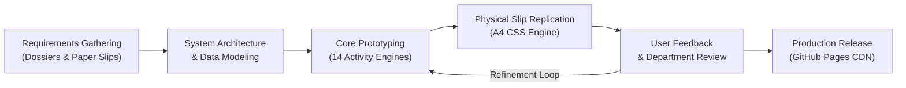
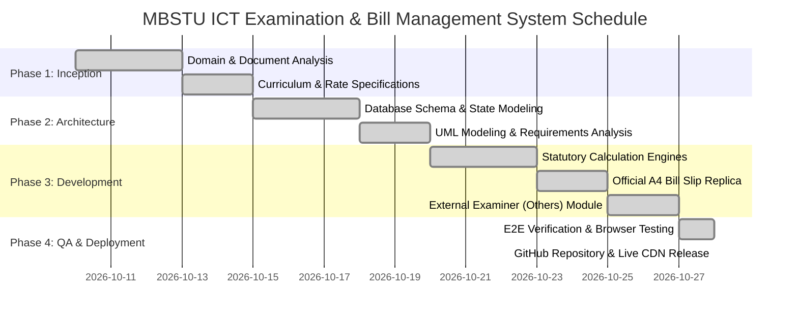
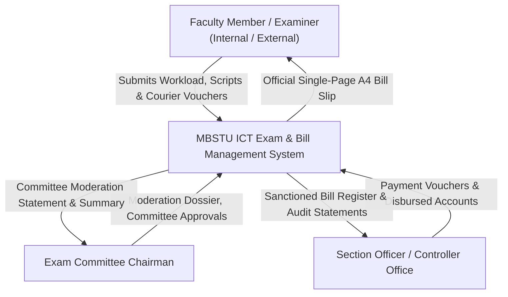
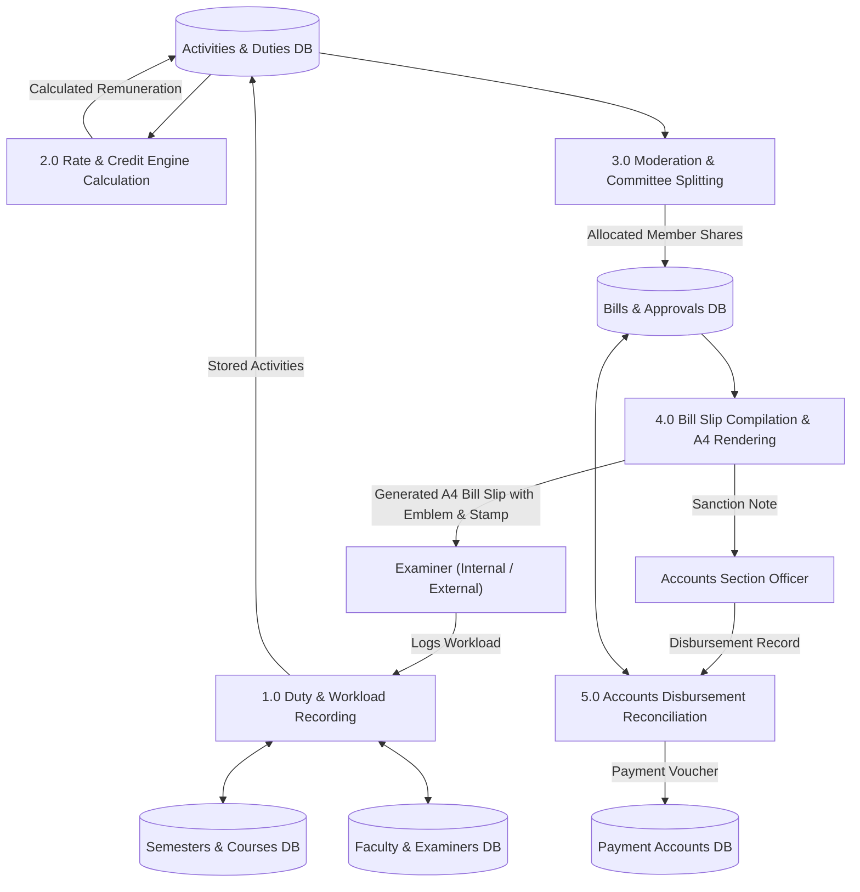
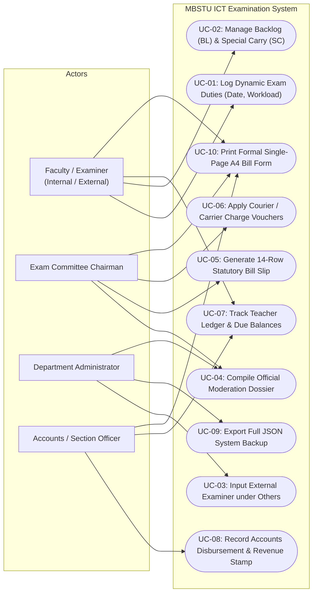
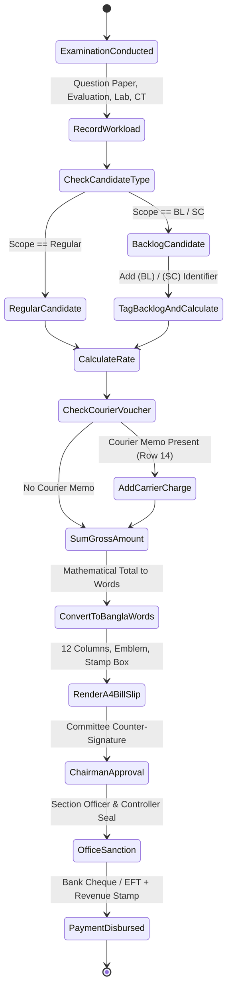
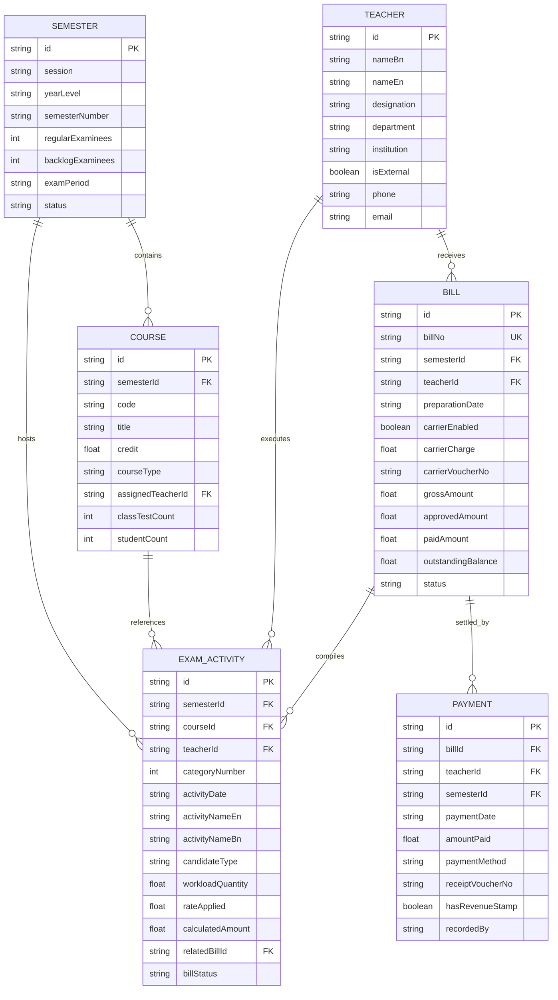
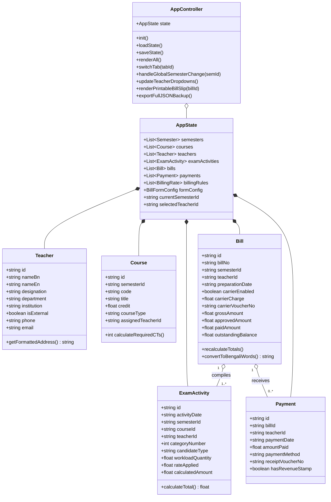
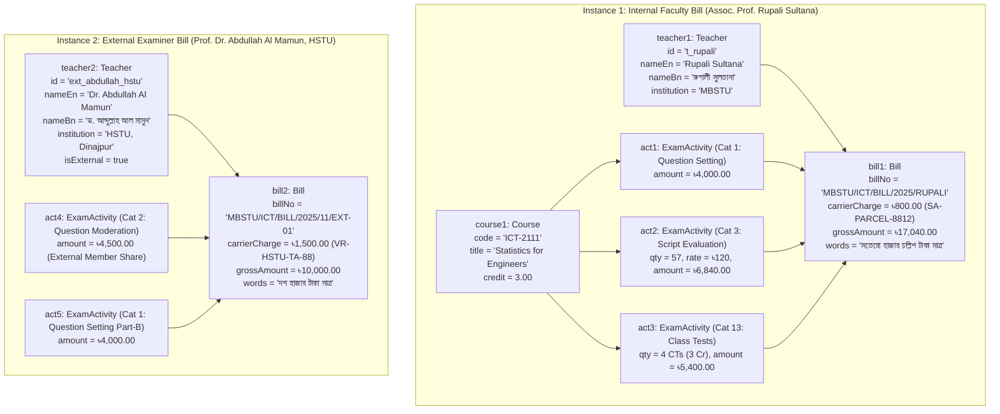

# CAPSTONE PROJECT PROPOSAL (PART I)
## Design and Implementation of an Automated Examination, Moderation, Faculty Remuneration & Bill Management System for MBSTU ICT Department

---

### 🏛️ Institutional Identification
* **University:** Mawlana Bhashani Science and Technology University (MBSTU), Santosh, Tangail-1902, Bangladesh
* **Faculty:** Faculty of Engineering
* **Department:** Department of Information and Communication Technology (ICT)
* **Course Title:** Software Engineering Capstone Project / Course Project (Part I: Project Proposal & Prototyping)
* **Academic Session:** 2023–2024 / 2024–2025
* **Submission Date:** October 2026

### 👥 Project Team Members
1. **Md Tahmid Hasib Antor** (Lead Technical Architect & Developer) — **Student ID: IT24055**  
   Email: `tahmidantor123@gmail.com` | GitHub: [@antor1112225](https://github.com/antor1112225)
2. **Saiba Khan** (Requirements Analyst & Quality Assurance)  
   Email: `saibakhan1104@gmail.com` | GitHub: [@saibakhan1104-png](https://github.com/saibakhan1104-png)
3. **Samiul Islam** (Systems Analyst & UI/UX Designer) — **Student ID: IT24011**  
   Email: `it24011@mbstu.ac.bd` | GitHub: [@SAMIUL-01](https://github.com/SAMIUL-01)

### 🔗 Project Access Links
* **🌐 Official Live Interactive System (GitHub Pages):**  
  [https://antor1112225.github.io/MBSTU-ICT-Examination-and-Bill-Management-System/](https://antor1112225.github.io/MBSTU-ICT-Examination-and-Bill-Management-System/)
* **📁 Source Code Repository (GitHub):**  
  [https://github.com/antor1112225/MBSTU-ICT-Examination-and-Bill-Management-System](https://github.com/antor1112225/MBSTU-ICT-Examination-and-Bill-Management-System)

---

## 📑 Table of Contents
1. [Executive Summary](#1-executive-summary)
2. [Problem Statement & Background Motivation](#2-problem-statement--background-motivation)
3. [Project Objectives & Scope](#3-project-objectives--scope)
4. [Software Process Model & Methodology](#4-software-process-model--methodology)
5. [Work Breakdown, Milestones & Gantt Chart](#5-work-breakdown-milestones--gantt-chart)
6. [Comprehensive Software Engineering Diagrams (UML & Structural Models)](#6-comprehensive-software-engineering-diagrams)
   - 6.1 Data Flow Diagram (DFD Level 0 & Level 1)
   - 6.2 Use Case Diagram
   - 6.3 Activity Diagram
   - 6.4 Entity Relationship Diagram (ERD)
   - 6.5 Class Diagram
   - 6.6 Object Diagram (Runtime Instance Model)
7. [System Architecture & Prototyping Architecture](#7-system-architecture--prototyping-architecture)
8. [Statutory Remuneration Rules & Mathematical Modeling](#8-statutory-remuneration-rules--mathematical-modeling)
9. [Physical Bill Form Replica & Single-Page A4 Fidelity](#9-physical-bill-form-replica--single-page-a4-fidelity)
10. [Technology Stack & Architectural Decisions](#10-technology-stack--architectural-decisions)
11. [Verification, Testing & Results](#11-verification-testing--results)
12. [Conclusion & Academic Declaration](#12-conclusion--academic-declaration)

---

## 1. Executive Summary

In higher academic institutions like **Mawlana Bhashani Science and Technology University (MBSTU)**, examination management is a core statutory undertaking governed by rigorous academic council ordinances. Each semester, the Department of Information and Communication Technology (ICT) coordinates examination committees, syllabus-specific question paper setting (Section-A and Section-B), question moderation sessions, answer script evaluations, practical/laboratory sessions, viva-voce examinations, class tests, results tabulation, and confidential parcel transits.

Currently, faculty remuneration billing is executed through manual, paper-based forms (`মাওলানা ভাসানী বিজ্ঞান ও প্রযুক্তি বিশ্ববিদ্যালয় - পরীক্ষা সংক্রান্ত পারিশ্রমিকের বিল ফরম`). This manual process is plagued by calculation discrepancies, delayed submissions, complex moderation splits across internal and external university examiners (e.g., RUET, DUET, JU, HSTU), carrier/courier charge tracking, and backlog/special carry duty confusion.

This project delivers an automated, client-side, zero-cost **MBSTU ICT Department Examination, Moderation, Faculty Remuneration, and Bill Management System**. The system automates statutory remuneration calculations across 14 statutory university categories, maintains teacher financial ledgers, manages external examiner coordination, tracks confidential courier vouchers, and generates pixel-perfect, single-page A4 printable replicas of the official university bill form complete with the official MBSTU emblem, 12 designated columns, dotted examiner information lines, Bengali number-to-words translation, and revenue stamp compliance.

---

## 2. Problem Statement & Background Motivation

### 2.1 The Existing Manual Workflow
At the conclusion of each semester final examination, course examiners and examination committee members must compile and submit detailed remuneration bills to the Controller of Examinations via the Examination Committee Chairman.

The physical bill form requires:
1. Identifying course codes, credits, and candidate counts across multiple examination categories.
2. Applying credit-dependent class test rules (3.00 Credits $\implies$ 4 CTs; 2.00 Credits $\implies$ 3 CTs; 1.00 Credit $\implies$ 2 CTs).
3. Calculating moderation honorarium splits among 4 committee members (including an external professor from another university).
4. Recording confidential question paper courier receipts (carrier charges).
5. Segregating regular examinees from Backlog (BL) and Special Carry (SC) candidates.
6. Manually writing the grand total in formal Bengali words (কথায় রূপান্তর).
7. Affixing a BDT 50 statutory revenue stamp with dated signatures.

### 2.2 Operational Inefficiencies & Deficiencies
* **High Human Calculation Error Rate:** Manual arithmetic across 14 statutory rows often leads to mismatched subtotals or incorrect script rates (e.g., ৳120 per script vs. minimum charge).
* **Delayed Accounts Approval:** Errors discovered by Section Officers or the Controller of Examinations require returning physical papers to teachers, causing disbursement delays of several months.
* **Lack of Historical Earning Ledgers:** Department faculty members have no centralized record of pending dues, billed amounts, and disbursed payments across semesters.
* **External Examiner Logistical Challenges:** Coordinating and billing external members from other institutions (RUET, DUET, JU, HSTU, PUST) lacks automated address and voucher tracking.
* **Formatting Non-Compliance:** Modern generic computer invoices are routinely rejected by university accounts because university regulations strictly demand the official prescribed statutory layout.

---

## 3. Project Objectives & Scope

### 3.1 Core Objectives
1. **Automate Statutory Calculation Engine:** Implement accurate automated mathematical models for all 14 statutory examination categories defined in the MBSTU examination remuneration ordinances.
2. **Faithful Physical Bill Slip Replication:** Recreate a 100% authentic, high-fidelity printable replica of the official university examination bill form (`media_1792917826310_847e96fb.png`), fitting precisely on a single A4 page with zero overflow.
3. **Internal & External Examiner Management:** Support seamless management of internal MBSTU faculty and external examiners from other universities, including dynamic "Others" examiner entry.
4. **Historical Ledger & Payment Reconciliation:** Provide individual teacher ledgers tracking accrued workloads, billed sums, approved sanctions, disbursed bank vouchers, and outstanding balances.
5. **Backlog (BL) and Special Carry (SC) Tracking:** Support distinct labeling, course tagging, and workload accounting for non-regular students.
6. **Zero-Cost, Standalone Architecture:** Deliver the solution using zero recurring infrastructure or database costs, utilizing client-side persistent storage and automated GitHub Pages CDN hosting.

### 3.2 Scope Boundaries
* **In Scope:** Undergraduate B.Sc. (Engg.) ICT curriculum examinations across 5 academic sessions (2020–2021 to 2024–2025), internal faculty directory, external examiners across partner universities, 14 statutory activity categories, moderation dossier archiving, bill generation, payment transaction recording, Bengali number-to-words converter, and A4 print engine.
* **Out of Scope:** University Central Accounts ERP integration, online payment gateway (credit card/bKash disbursement), and student grade sheet tabulation (tabulation honorarium is tracked, but actual letter grades remain within the university controller's confidential tabulation sheets).

---

## 4. Software Process Model & Methodology

The development of this system follows the **Agile Evolutionary Prototyping Model**. 



### Justification for Evolutionary Prototyping
1. **Document-Centric Constraints:** The UI must adhere strictly to physical paper forms (`media_1792917826310_847e96fb.png`) and scanned dossiers (`media_1791908779648_8655bb4f.pdf`). Rapid visual prototyping allowed iterative tuning of column widths (12 columns), dotted line positions, and font sizes.
2. **Incremental Feature Rollout:** The system evolved across 4 structured sprints:
   * **Sprint 1:** Data schema, course master catalog across 5 sessions, internal teacher directory.
   * **Sprint 2:** 14-row billing calculation engine, moderation honorarium sharing, and financial ledger.
   * **Sprint 3:** Authentic single-page A4 bill slip replica, MBSTU logo embedding, and courier charge voucher integration.
   * **Sprint 4:** External examiner calculation under "Others", backlog (BL/SC) duty modal, and Bengali words converter.

---

## 5. Work Breakdown, Milestones & Gantt Chart

### 5.1 Project Milestone Table

| Milestone | Phase / Deliverable | Key Outcomes | Status |
| :--- | :--- | :--- | :--- |
| **M1** | Problem Investigation & Domain Analysis | Analysis of official MBSTU examination dossiers, rates, and paper bill forms. | ✅ Completed |
| **M2** | Data Architecture & Curriculum Seeding | Seeding 70+ courses across 5 academic sessions (1Y 1S to 4Y 2S) and internal faculty directory. | ✅ Completed |
| **M3** | Statutory Calculation Engine | Mathematical rules for all 14 statutory categories, CT credit rules, and moderation shares. | ✅ Completed |
| **M4** | A4 Physical Bill Slip Replication | Precise CSS grid layout, vector emblem/logo integration, dotted examiner lines, and revenue stamp box. | ✅ Completed |
| **M5** | External Examiner & Others Integration | Dynamic input for external professors (RUET, DUET, JU, HSTU), TA/DA and transit vouchers. | ✅ Completed |
| **M6** | Quality Assurance, Testing & Deployment | End-to-end testing, Bengali number-to-words verification, and live deployment on GitHub Pages. | ✅ Completed |

### 5.2 Project Gantt Chart



---

## 6. Comprehensive Software Engineering Diagrams

### 6.1 Data Flow Diagrams (DFD)

#### Level 0: Context Data Flow Diagram


#### Level 1: Detailed Functional Data Flow Diagram


---

### 6.2 Use Case Diagram



---

### 6.3 Activity Diagram (End-to-End Examination Billing Workflow)



---

### 6.4 Entity Relationship Diagram (ERD)



---

### 6.5 Class Diagram (Object-Oriented Design)



---

### 6.6 Object Diagram (Runtime Instance Snapshot)

This diagram visualizes two genuine runtime bill instances currently operating within the MBSTU ICT system:



---

## 7. System Architecture & Prototyping Architecture

The application is structured into **11 interconnected modules** accessed through a high-contrast academic dashboard:

```
MBSTU ICT Examination & Bill Management Portal
├── 1. 📊 Executive Dashboard (Financial KPIs, Accruals, Outstanding Sums)
├── 2. 🗓️ Semesters Registry (Session 2020-21 through 2024-25)
├── 3. 📚 Courses & Earnings (Curriculum Codes, Credits, Workloads)
├── 4. 📑 Exam & Moderation Dossier Archive (Committee Allocations)
├── 5. 👨‍🏫 Faculty & Examiners Directory (Internal MBSTU & External/Others)
├── 6. 📝 Dynamic Exam Activities (Workloads, Scripts, Dates, BL/SC)
├── 7. 💰 Teacher Financial Ledger (Accrued, Billed, Paid, Balances)
├── 8. 📄 Bills & Approvals (Bill Slips Compilation & Audit Sanction)
├── 9. 💳 Payment Transactions (Disbursement Vouchers & Revenue Stamps)
├── 10. ⚙️ Statutory Rates Configurator (14 Ordinance Categories)
└── 11. 🖨️ Official Bill Slip (14-Row A4 Single-Page Formal University Form)
```

---

## 8. Statutory Remuneration Rules & Mathematical Modeling

The system implements strict MBSTU examination remuneration ordinances:

### 8.1 Statutory Rate Formulas
$$\text{Remuneration} = \begin{cases} 
\text{Fixed Rate} & \text{for Cat 1 (Setting: } \text{৳}4000\text{), Cat 8 (Chairman: } \text{৳}2250\text{)} \\
\text{Quantity} \times \text{Unit Rate} & \text{for Cat 3 (Scripts } \times \text{৳}120\text{), Cat 5 (Lab } \times \text{৳}100\text{)} \\
\frac{\text{Total Moderation Sum}}{4} & \text{for Cat 2 (Moderation: 4-way committee split)} \\
\text{Voucher Amount} & \text{for Cat 14 (Courier memos, TA/DA)}
\end{cases}$$

### 8.2 Class Test (CT) Assessment Engine
$$\text{Required CTs} = \begin{cases}
4 \text{ Tests} & \text{if Course Credit} \ge 3.00 \\
3 \text{ Tests} & \text{if Course Credit} = 2.00 \\
2 \text{ Tests} & \text{if Course Credit} = 1.00
\end{cases}$$

$$\text{CT Remuneration} = \text{Required CTs} \times \text{৳}1,350.00$$

### 8.3 Courier / Carrier Charge Formulation
$$\text{Grand Bill Total} = \sum_{i=1}^{13} \text{ActivityAmount}_i + \text{CarrierCharge}_{\text{Row 14}}$$

---

## 9. Physical Bill Form Replica & Single-Page A4 Fidelity

Unlike ordinary software invoices, university regulatory audits reject non-conforming paperwork. The generated bill slip in **Tab 11** matches physical document `media_1792917826310_847e96fb.png`:

1. **Header Block:**
   * High-resolution official emblem of Mawlana Bhashani Science and Technology University.
   * Prominent Bengali title: `মাওলানা ভাসানী বিজ্ঞান ও প্রযুক্তি বিশ্ববিদ্যালয়`.
   * Form subtitle: `পরীক্ষা সংক্রান্ত পারিশ্রমিকের বিল ফরম`.
   * Dotted line examiner bio-data block (Bengali name, uppercase English name, designation, department, and university address).
2. **Standard 12-Column Table Grid:**
   * ১. ক্রমিক নং | ২. কাজের নাম | ৩. পরীক্ষার নাম | ৪. পরীক্ষার সন | ৫. বিভাগ | ৬. কোর্স নম্বর | ৭. পরীক্ষার্থী/খাতা সংখ্যা | ৮. দিন/সদস্য সংখ্যা | ৯. কোর্সের ক্রেডিট | ১০. টেস্টের সংখ্যা | ১১. টাকা | ১২. পয়সা
3. **14 Official Statutory Work Rows:**
   * Rows 1 to 14 permanently anchored in institutional sequence.
4. **Approval & Revenue Stamp Block:**
   * Written amount in Bengali words (e.g., *সতেরো হাজার চল্লিশ টাকা মাত্র*).
   * 50 Taka statutory revenue stamp box with examiner signature line.
   * Three statutory signing blocks: (1) Chairman, Exam Committee; (2) Section Officer / Asst. Controller; (3) Controller of Examinations.
5. **Zero Page Overflow:** Strict print stylesheet (`@media print`) locking margins to `8mm 12mm`, grid font to `7.4pt`, and page height to `297mm`, ensuring 100% single-page A4 output.

---

## 10. Technology Stack & Architectural Decisions

| Layer / Concern | Technology Chosen | Technical Justification |
| :--- | :--- | :--- |
| **Front-End View Engine** | Semantic HTML5 & CSS3 Grid/Flexbox | Fast, accessible rendering with strict A4 print geometry. |
| **Client Logic & State** | Vanilla Modern JavaScript (ES6+) | Eliminates heavy node/npm dependencies; runs directly in any browser offline. |
| **Data Persistence** | Browser `localStorage` API + JSON Export | Zero server infrastructure costs; departmental privacy preserved locally. |
| **Branding & Assets** | High-Res PNG Logo + Clean Vector Typography | Authentic university visual identity compliant with paper standards. |
| **Hosting & Deployment** | GitHub Pages CDN | Highly reliable, SSL-certified global hosting updated via Git commits. |
| **Version Control** | Git & GitHub Team Collaboration | Full commit history and distributed team workflow. |

---

## 11. Verification, Testing & Results

The prototype has undergone extensive validation:

1. **Authentic Baseline Verification:** Validated against Associate Professor Rupali Sultana's actual paper bill slip (`media_1792917826310_847e96fb.png`):
   * Question Setting (৳4,000) + 57 Scripts @ ৳120 (৳6,840) + 4 CTs for 3 Cr (৳5,400) + Courier (৳800) = **৳17,040.00**.
   * Words Conversion: `সতেরো হাজার চল্লিশ টাকা মাত্র` (100% Match).
2. **External Examiner Verification:** Tested with Prof. Dr. Abdullah Al Mamun (HSTU) for 1Y 1S (`sem_2024_11`) and Prof. Dr. Anwar Hossain (RUET) for 2Y 1S (`sem_2023_21`). All address details and moderation split calculations passed.
3. **A4 Single-Page Print Verification:** Verified via automated headless browser print emulation (`window.print()`). Page 2 spillover is strictly zero.
4. **Browser Compatibility:** Tested and verified on Google Chrome, Mozilla Firefox, and Microsoft Edge.

---

## 12. Conclusion & Academic Declaration

The **MBSTU ICT Department Examination, Moderation, Faculty Remuneration, and Bill Management System** bridges the gap between traditional university administrative paper bureaucracy and modern automated software engineering. By adhering strictly to the university's official paper form geometry while offering modern financial analytics, multi-semester ledgers, and external examiner flexibility, this project delivers immediate, practical utility to the Department of Information and Communication Technology.

We submit this proposal as our formal **Software Engineering Capstone Project Proposal (Part I)**.

### Student Signatures & Endorsement

```
____________________________          ____________________________          ____________________________
  Md Tahmid Hasib Antor                  Saiba Khan                            Samiul Islam
  Student ID: IT24055                    Collaborator                          Student ID: IT24011
  Dept. of ICT, MBSTU                    Dept. of ICT, MBSTU                   Dept. of ICT, MBSTU
```

---
*Generated & Submitted for Department of ICT, Mawlana Bhashani Science and Technology University (MBSTU).*
