# MAWLANA BHASHANI SCIENCE AND TECHNOLOGY UNIVERSITY
## FACULTY OF ENGINEERING
### DEPARTMENT OF INFORMATION AND COMMUNICATION TECHNOLOGY (ICT)

<br/>

<p align="center">
  
</p>

<br/>

# SOFTWARE ENGINEERING CAPSTONE PROJECT & LAB REPORT
## (THESIS BOOK & COMPREHENSIVE PROJECT REPORT)

---

### **Project Title:**
# DESIGN AND IMPLEMENTATION OF AN AUTOMATED EXAMINATION, MODERATION, FACULTY REMUNERATION AND BILL MANAGEMENT SYSTEM FOR MBSTU ICT DEPARTMENT

---

### **Submitted By:**
**Md Tahmid Hasib Antor**  
**Student ID: IT24055**  
Degree: Bachelor of Science in Information and Communication Technology (B.Sc. Engg. in ICT)  
Department of Information and Communication Technology (ICT)  
Faculty of Engineering  
Mawlana Bhashani Science and Technology University, Santosh, Tangail-1902, Bangladesh  
Email: `tahmidantor123@gmail.com` | `it24055@mbstu.ac.bd`  
GitHub: [@antor1112225](https://github.com/antor1112225)

---

### **Submitted To:**
**Course Evaluation Committee & Department Faculty Members**  
Department of Information and Communication Technology (ICT)  
Faculty of Engineering  
Mawlana Bhashani Science and Technology University (MBSTU)

---

### **Academic Identification:**
* **Course Title:** Software Engineering Laboratory / Capstone Course Project
* **Course Code:** ICT 2202 / ICT Capstone
* **Academic Session:** 2023–2024 / 2024–2025
* **Date of Submission:** October 2026
* **Institutional Repository:** [GitHub - antor1112225/MBSTU-ICT-Examination-and-Bill-Management-System](https://github.com/antor1112225/MBSTU-ICT-Examination-and-Bill-Management-System)
* **Live System Deployment:** [GitHub Pages - Live Interactive Web App](https://antor1112225.github.io/MBSTU-ICT-Examination-and-Bill-Management-System/)

<br/><br/>

---

## 📜 STUDENT'S DECLARATION

I hereby solemnly declare that the work presented in this Software Engineering Capstone Project & Lab Report titled **"Design and Implementation of an Automated Examination, Moderation, Faculty Remuneration and Bill Management System for MBSTU ICT Department"** is an original development carried out by me under the academic guidance of the Department of Information and Communication Technology (ICT), Mawlana Bhashani Science and Technology University (MBSTU).

I confirm that:
1. This report and the developed software system represent my own personal and independent academic effort.
2. The empirical remuneration rules, mathematical formulas, and form geometries adhere strictly to the authentic examination ordinances and official paper forms of MBSTU.
3. This work has not been previously submitted in part or full for any degree, diploma, or other academic qualification at this or any other educational institution.
4. All software architectural models, diagrams, and codebase implementations conform to standard software engineering ethics, documentation integrity, and academic honesty.

<br/>

```
Date: October 28, 2026
Place: Santosh, Tangail

____________________________________________________________
Md Tahmid Hasib Antor
Student ID: IT24055
Department of Information and Communication Technology (ICT)
Faculty of Engineering
Mawlana Bhashani Science and Technology University (MBSTU)
```

<br/><br/>

---

## 🏛️ CERTIFICATE OF APPROVAL

This is to certify that the Software Engineering Capstone Project and Lab Report titled **"Design and Implementation of an Automated Examination, Moderation, Faculty Remuneration and Bill Management System for MBSTU ICT Department"**, submitted by **Md Tahmid Hasib Antor (Student ID: IT24055)**, has been examined, presented, and accepted as satisfactory in partial fulfillment of the requirements for the course of Software Engineering Laboratory in the Department of Information and Communication Technology (ICT), Faculty of Engineering, Mawlana Bhashani Science and Technology University.

<br/>

### **Board of Examiners / Evaluation Committee:**

<br/>

```
1. ______________________________________             Date: __________________
   Course Instructor / Supervisor
   Department of ICT, MBSTU

2. ______________________________________             Date: __________________
   External / Committee Member
   Department of ICT, MBSTU

3. ______________________________________             Date: __________________
   Chairman
   Department of Information and Communication Technology
   Mawlana Bhashani Science and Technology University
```

<br/><br/>

---

## 🙏 DEDICATION & ACKNOWLEDGEMENTS

First and foremost, all praises are due to the Almighty for providing the strength, perseverance, and intellectual capability required to successfully conceptualize, architect, and deliver this comprehensive software system and academic thesis report.

I express my deepest gratitude and sincere appreciation to the respected faculty members of the **Department of Information and Communication Technology (ICT)** at **Mawlana Bhashani Science and Technology University (MBSTU)**. Their insightful lectures, continuous guidance, and rigorous academic standards in Software Engineering, Database Systems, and System Analysis have formed the bedrock of this project.

Special thanks are conveyed to the departmental administrative staff and examination section officials who graciously provided access to statutory examination guidelines, remuneration rates, and official paper bill templates. Their practical insights into the manual calculation challenges and reconciliation hurdles faced after each semester examination made it possible to design an automated solution that provides genuine, everyday utility.

Finally, I dedicate this work to my family for their continuous sacrifices and moral encouragement throughout my academic journey.

<br/>
**Md Tahmid Hasib Antor (IT24055)**  
*Department of ICT, MBSTU*

<br/><br/>

---

## 📖 ABSTRACT

The administrative processing of semester examinations in public universities in Bangladesh represents an intricate, paper-heavy bureaucratic challenge. At Mawlana Bhashani Science and Technology University (MBSTU), the Department of Information and Communication Technology (ICT) conducts semester final examinations across four academic years. Concluding each semester requires computing financial remuneration for course teachers, exam committee members, and external examiners across fourteen statutory responsibility categories, including question setting, moderation, answer script evaluation, laboratory examinations, class tests, and carrier expenditures. Historically, this workflow relied entirely on manual paper tabulation and physical bill forms (`পরীক্ষা সংক্রান্ত পারিশ্রমিকের বিল ফরম`), leading to mathematical discrepancies, delayed disbursements, absent historical ledgers, and zero transparency between accrued dues and actual accounts clearance.

This capstone project presents the design and end-to-end implementation of the **MBSTU ICT Department Examination, Moderation, Faculty Remuneration and Bill Management System**—a high-performance, client-side enterprise web platform developed using vanilla web standards (HTML5, CSS3, ES6+ JavaScript, and structured `localStorage`). The system embodies an **Agile Evolutionary Prototyping** lifecycle, addressing both the modern analytical needs of university administration and the strict physical constraints of institutional bureaucracy. 

Key technical contributions include:
1. **Mathematical Honorarium Modeling:** Implementation of strict statutory rules for 14 examination categories, including credit-sensitive Class Test ceilings ($3.00\text{ Cr} \implies 4\text{ CTs}$, $2.00\text{ Cr} \implies 3\text{ CTs}$, $1.00\text{ Cr} \implies 2\text{ CTs}$) and automatic 4-member moderation splits.
2. **Physical Bill Form Fidelity:** A dedicated print engine faithfully recreating the official 12-column university bill form on standard A4 portrait paper with zero-spillover CSS print styling and dynamic Bengali number-to-words currency translation.
3. **Faculty Earnings Ledger:** Real-time financial reconciliation tracking Accrued Work $\implies$ Bill Prepared $\implies$ Chairman Approved $\implies$ Disbursed Payment $\implies$ Outstanding Dues across multiple academic semesters.
4. **External Examiner Integration:** Frictionless voucher and travel reimbursement tracking for external professors from peer institutions (e.g., RUET, DUET, JU, HSTU, PUST).

Rigorous empirical validation against authentic historical MBSTU paper records confirmed 100% calculation precision and zero-margin error against ground-truth paper bills (including Associate Professor Rupali Sultana's ৳17,040 bill slip). This platform completely eliminates manual calculation bottlenecks and establishes a reproducible paradigm for university examination administration.

**Keywords:** University Examination Billing, Faculty Remuneration, Academic Ordinance Automation, Agile Prototyping, A4 Print Fidelity, Bengali Currency Engine, Software Engineering Capstone, MBSTU ICT.

<br/>

### সারসংক্ষেপ (Bengali Abstract)
মাওলানা ভাসানী বিজ্ঞান ও প্রযুক্তি বিশ্ববিদ্যালয়ের (MBSTU) তথ্য ও যোগাযোগ প্রযুক্তি (ICT) বিভাগে প্রতি সেমিস্টার ফাইনাল পরীক্ষা শেষে কোর্স শিক্ষক, পরীক্ষা কমিটির সভাপতি ও সদস্য এবং অন্যান্য বিশ্ববিদ্যালয়ের বহিরাগত পরীক্ষকদের ১৪টি সংবিধিবদ্ধ খাতে পারিশ্রমিক ও বিল প্রস্তুত করতে হয়। সনাতন কাগজের বিল ফরমে হিসাব করার কারণে প্রায়শই জটিলতা, ভুলের আশঙ্কা এবং দীর্ঘসূত্রতা সৃষ্টি হতো। এই ক্যাপস্টোন প্রজেক্টের মাধ্যমে একটি স্বয়ংসম্পূর্ণ, স্বয়ংক্রিয় এবং ব্যবহারবান্ধব ওয়েব-ভিত্তিক সফটওয়্যার সিস্টেম বাস্তবায়ন করা হয়েছে। সিস্টেমটি বিশ্ববিদ্যালয়ের অফিশিয়াল ১২-কলামের বিল ফরমের সাথে শতভাগ সামঞ্জস্য রেখে A4 সাইজের প্রিন্টেবল বিল তৈরি করে, কথায় বাংলায় টাকা রূপান্তর করে, শিক্ষকভিত্তিক আয়-ব্যয় লেজার সংরক্ষণ করে এবং বহিরাগত শিক্ষকদের হিসাব সুষ্ঠুভাবে সম্পাদন করে। বাস্তব বিলের সাথে যাচাইকরণে সিস্টেমটি শতভাগ নির্ভুল ফলাফল প্রদান করেছে।

<br/><br/>

---

## 📑 TABLE OF CONTENTS

* **Title Page**
* **Student's Declaration**
* **Certificate of Approval**
* **Dedication & Acknowledgements**
* **Abstract & সারসংক্ষেপ**
* **Table of Contents**
* **List of Figures**
* **List of Tables**
* **List of Abbreviations**
* **Chapter 1: Introduction**
  * 1.1 Motivation & Institutional Background
  * 1.2 Problem Statement & Analysis of Manual Bottlenecks
  * 1.3 Project Objectives & Proposed Solution
  * 1.4 Scope and Delimitations
  * 1.5 Dissertation Organization
* **Chapter 2: Literature Review & Statutory Domain Analysis**
  * 2.1 Examination Management Systems in Higher Education
  * 2.2 Shortcomings of Generic ERP and Invoicing Systems
  * 2.3 MBSTU Examination Ordinance & Statutory Remuneration Framework
  * 2.4 Artifact Archaeology: The Physical Examination Bill Slip
  * 2.5 Analysis of the 14 Examination Duty Categories & Mathematical Formulations
  * 2.6 Class Test Ceiling Formulas by Course Credit
  * 2.7 Cross-University External Examiner Honoraria & Logistical Coordination
* **Chapter 3: System Requirements & Software Process Model**
  * 3.1 Software Development Life Cycle: Agile Evolutionary Prototyping
  * 3.2 Stakeholder Analysis & User Personas
  * 3.3 Functional Requirements Specification (FR-01 to FR-16)
  * 3.4 Non-Functional Requirements Specification (NFR-01 to NFR-10)
  * 3.5 System Work Breakdown Structure (WBS) & Milestones
* **Chapter 4: Visual System Modeling & Architectural Design**
  * 4.1 System Architecture Pattern (Modular MVC/MVVM Client Engine)
  * 4.2 Data Flow Diagrams (DFD Level 0, Level 1, Level 2)
  * 4.3 Use Case Modeling & Scenario Specifications
  * 4.4 Behavioral Modeling (Activity, Sequence & State Transition Diagrams)
  * 4.5 Structural Data Modeling (Entity Relationship Diagram & Data Dictionary)
  * 4.6 Object-Oriented Domain Modeling (Class Diagram & Runtime Object Diagram)
  * 4.7 Component & Deployment Architecture
* **Chapter 5: Implementation Walkthrough & User Interface Architecture**
  * 5.1 Technology Stack & Zero-Dependency Architectural Decision
  * 5.2 Header Navigation & Consolidated Multi-Semester Controller
  * 5.3 Executive Dashboard & Institutional Financial Analytics
  * 5.4 Course Allocation & Faculty Workload Registry
  * 5.5 Dynamic 14-Category Examination Activity Logger
  * 5.6 Question Moderation Honorarium Splitting Engine
  * 5.7 Dynamic External Examiner Input Mechanism ("Others" Faculty Support)
  * 5.8 Faculty Earning & Payment Ledger (Financial Accounting Engine)
  * 5.9 Authentic 1:1 University Bill Slip Generator & Single-Page A4 Precision Layout
  * 5.10 Automated Bengali Number-to-Words Conversion Engine
  * 5.11 Data Persistence, Schema Validation, JSON Backup & CSV Export
* **Chapter 6: System Verification, Empirical Testing & Experimental Results**
  * 6.1 Testing Methodology & Test Suite Design
  * 6.2 Ground-Truth Validation Against Authentic MBSTU Physical Bill Slips
  * 6.3 Automated End-to-End Test Execution & Results Matrix
  * 6.4 Browser Compatibility & Performance Benchmarks
  * 6.5 Print Engine Precision & Zero-Spillover Verification
* **Chapter 7: Discussion, Academic Contributions & Future Directions**
  * 7.1 Impact on University Examination Operations
  * 7.2 Comparative Analysis: Manual Process vs Generic ERP vs MBSTU System
  * 7.3 Security, Data Confidentiality & Fraud Prevention
  * 7.4 Limitations & Roadmap for Future Enhancements
* **Chapter 8: Conclusion**
* **References**
* **Appendices**
  * Appendix A: MBSTU Statutory Remuneration Schedule
  * Appendix B: Sample System Data Structures (JSON)
  * Appendix C: Project Repository & Live Deployment Links

<br/><br/>

---

## 🖼️ LIST OF FIGURES

* **Figure 2.1:** Official MBSTU Physical Examination Remuneration Bill Form (`screenshots/reference_paper_bill_form.png`)
* **Figure 3.1:** Agile Evolutionary Prototyping Process Model Flowchart
* **Figure 4.1:** Data Flow Diagram (DFD) Level 0 — Context Diagram
* **Figure 4.2:** Data Flow Diagram (DFD) Level 1 — Functional Decomposition Diagram
* **Figure 4.3:** Data Flow Diagram (DFD) Level 2 — Bill Generation & Payment Processing
* **Figure 4.4:** Use Case Diagram of the MBSTU ICT Examination & Bill Management System
* **Figure 4.5:** Activity Diagram of End-to-End Examination Billing Lifecycle
* **Figure 4.6:** Sequence Diagram of Duty Assignment, Bill Generation & Payment Clearance
* **Figure 4.7:** State Machine Diagram of Duty Activity and Bill Voucher Lifecycle
* **Figure 4.8:** Entity Relationship Diagram (ERD) with Multiplicity Constraints
* **Figure 4.9:** Object-Oriented Domain Class Diagram
* **Figure 4.10:** Runtime Object Diagram Modeling Live In-Memory Instances
* **Figure 4.11:** System Component and Deployment Diagram
* **Figure 5.1:** Header Navigation with Multi-Semester Dropdown and Proposal Button (`screenshots/01_semester_switch_2020_2021.png`)
* **Figure 5.2:** Executive Financial Analytics Dashboard & KPI Cards (`screenshots/dashboard_overview.png`)
* **Figure 5.3:** Consolidated Multi-Semester Examination Summary (`screenshots/02_consolidated_dashboard.png`)
* **Figure 5.4:** Course Allocation Grid and Teacher Workload Breakdown (`screenshots/05_course_teacher_assignments.png`)
* **Figure 5.5:** Detailed Course Activity Decomposition Modal (`screenshots/06_course_breakdown_modal.png`)
* **Figure 5.6:** Question Moderation Honorarium Register with Member Allocation (`screenshots/04_moderation_register.png`)
* **Figure 5.7:** Individual Faculty Earning & Payment Ledger for Dr. Monir Morshed (`screenshots/03_teacher_ledger_monir_morshed.png`)
* **Figure 5.8:** Historical Payment Ledger Audit Trail for Dr. Nargis Aktar (`screenshots/teacher_ledger_nargis.png`)
* **Figure 5.9:** Official 1:1 Generated A4 University Bill Slip for Dr. Monir Morshed (`screenshots/07_official_bill_slip_monir.png`)
* **Figure 5.10:** High-Fidelity Printable Examination Bill Slip (`screenshots/official_printable_bill_slip.png`)

<br/><br/>

---

## 📊 LIST OF TABLES

* **Table 2.1:** Statutory Rate Structure for 14 Examination Duties at MBSTU
* **Table 2.2:** Statutory Class Test Ceiling Matrix by Course Credit Hour
* **Table 3.1:** Functional Requirements Specification Matrix (FR-01 to FR-16)
* **Table 3.2:** Non-Functional Requirements Specification Matrix (NFR-01 to NFR-10)
* **Table 3.3:** Project Work Breakdown Structure (WBS) & Milestones
* **Table 4.1:** Core Use Case Specification Summary
* **Table 4.2:** Relational Data Model Schema & Field Specifications
* **Table 6.1:** Ground-Truth Validation Comparison for Associate Professor Rupali Sultana
* **Table 6.2:** Comprehensive End-to-End Test Matrix & Verification Outcomes
* **Table 6.3:** Cross-Browser Rendering & JavaScript Execution Benchmarks
* **Table 7.1:** Feature Comparison Matrix: Legacy Manual vs Generic ERP vs MBSTU System

<br/><br/>

---

## 🔤 LIST OF ABBREVIATIONS & ACRONYMS

| Abbreviation | Expanded Definition |
| :--- | :--- |
| **MBSTU** | Mawlana Bhashani Science and Technology University |
| **ICT** | Information and Communication Technology |
| **DFD** | Data Flow Diagram |
| **ERD** | Entity Relationship Diagram |
| **UML** | Unified Modeling Language |
| **SRS** | Software Requirements Specification |
| **WBS** | Work Breakdown Structure |
| **MVC** | Model-View-Controller |
| **MVVM** | Model-View-ViewModel |
| **CT** | Class Test |
| **Cr** | Credit Hours |
| **KPI** | Key Performance Indicator |
| **JSON** | JavaScript Object Notation |
| **CSV** | Comma-Separated Values |
| **DOM** | Document Object Model |
| **CSS** | Cascading Style Sheets |
| **HTML** | Hypertext Markup Language |
| **BL** | Backlog (Examinee Category) |
| **SC** | Special Carry / Short Credit (Examinee Category) |
| **RUET** | Rajshahi University of Engineering & Technology |
| **DUET** | Dhaka University of Engineering & Technology |
| **JU** | Jahangirnagar University |
| **HSTU** | Hajee Mohammad Danesh Science & Technology University |
| **PUST** | Pabna University of Science and Technology |

<br/><br/>

---

# CHAPTER 1: INTRODUCTION

## 1.1 Academic Motivation & Institutional Background

Higher education institutions in Bangladesh operate under strict academic ordinances governing undergraduate and postgraduate degree curricula. At **Mawlana Bhashani Science and Technology University (MBSTU)**, established in Santosh, Tangail, academic excellence is anchored within a rigorous semester-based course credit system. The **Department of Information and Communication Technology (ICT)** conducts undergraduate degree programs (B.Sc. Engineering in ICT) spanning four academic years, subdivided into eight distinct semesters:
- **1st Year 1st Semester (1Y 1S)** and **1st Year 2nd Semester (1Y 2nd)**
- **2nd Year 1st Semester (2Y 1S)** and **2nd Year 2nd Semester (2Y 2S)**
- **3rd Year 1st Semester (3Y 1S)** and **3rd Year 2nd Semester (3Y 2S)**
- **4th Year 1st Semester (4Y 1S)** and **4th Year 2nd Semester (4Y 2S)**

Each semester's culmination involves extensive formal evaluation processes governed by a dedicated **Examination Committee** constituted in accordance with the university examination ordinance. The committee comprises:
1. **Chairman:** A senior departmental faculty member responsible for overall coordination, confidential printing, schedule execution, and final bill vetting.
2. **Internal Members:** Departmental course teachers and examiners.
3. **External Member:** An esteemed professor from another recognized public university of engineering and technology (e.g., RUET, DUET, JU, HSTU, PUST) appointed to ensure academic neutrality and moderation standards.

The evaluation process mandates diverse academic and administrative responsibilities ranging from confidential question setting and moderation to laboratory examinations, continuous assessments, and tabulation. Upon examination completion, course teachers, committee members, and external experts are entitled to statutory honoraria approved by the university syndicate.

## 1.2 Problem Statement & Analysis of Pre-Automation Bottlenecks

Despite the digital curriculum taught within the ICT department, the administrative process of compiling examination activities, calculating faculty remuneration, and printing bills has remained largely paper-bound and manual. This legacy workflow presents critical institutional pain points:

1. **Mathematical Inconsistencies & Human Error:**
   Each teacher's semester remuneration aggregates diverse tasks governed by different mathematical unit rates (per script, per credit hour, per examinee, or per board). Manual arithmetic calculation on handwritten slips frequently results in rate misapplications, omission of eligible class tests, or incorrect script tallies.

2. **The Moderation Splitting Bottleneck:**
   Statutory ordinance assigns a lump-sum moderation allowance (typically ৳18,000 per semester) to be apportioned strictly equally among the four examination committee members (৳4,500 each). In manual billing, examiners frequently miscalculated their proportional share or failed to record the external member's portion.

3. **Absence of Historical Faculty Ledgers:**
   Paper vouchers are submitted to the university accounts office as one-off physical forms. Once submitted, individual teachers and department heads possess no centralized record of total accrued dues, disbursed amounts, or pending university liabilities across different academic years.

4. **External Examiner Logistical Complexities:**
   External professors travelling from other universities require specialized billing accommodating carrier/courier expenses, non-local institutional addresses, and discrete payment vouchers. Under manual processes, missing voucher details frequently caused month-long payment delays.

5. **Lack of Format Conformity with University Forms:**
   Standard commercial accounting software or generic spreadsheet solutions generate modern, invoice-style documents that fail to comply with the university's statutory 12-column Bengali paper format (`পরীক্ষা সংক্রান্ত পারিশ্রমিকের বিল ফরম`). University audit and accounts branches strictly reject any bill that does not conform to the physical geometry, required signatures, and Bengali currency in words.

## 1.3 Project Objectives & Proposed Solution

To resolve these longstanding administrative impediments, this project delivers the **MBSTU ICT Department Examination, Moderation, Faculty Remuneration and Bill Management System**. The system has been designed with the following primary objectives:

- **Objective 1 (Statutory Compliance):** Implement a zero-defect calculation engine codifying all 14 official MBSTU examination honorarium categories, credit-specific ceilings, and moderation splits.
- **Objective 2 (Visual & Physical Form Fidelity):** Recreate the official university paper bill slip (`মাওলানা ভাসানী বিজ্ঞান ও প্রযুক্তি বিশ্ববিদ্যালয় - পরীক্ষা সংক্রান্ত পারিশ্রমিকের বিল ফরম`) with 100% geometric and typographic fidelity on standard A4 portrait paper.
- **Objective 3 (Institutional Financial Transparency):** Provide dedicated faculty-wise earning ledgers and multi-semester analytical dashboards tracking Accrued Work, Bills Prepared, Chairman Approvals, and Accounts Disbursements.
- **Objective 4 (Cross-Institutional Flexibility):** Seamlessly incorporate external university examiners under standard departmental records with dedicated address fields and carrier expense tracking.
- **Objective 5 (Zero-Cost, Resilient Architecture):** Engineer an offline-first, client-side web architecture with zero server subscription costs, instantaneous calculation speeds, and robust local data backup/restore mechanisms.

## 1.4 Scope and Delimitations

### In Scope:
- Complete coverage of undergraduate semesters (1Y 1S to 4Y 2S) for regular, backlog (BL), and special carry (SC) cohorts.
- Universal faculty registry supporting both internal MBSTU teachers and external faculty members.
- Dynamic 14-category activity logging with real-time rate application.
- Automated generation of printable 12-column A4 bill slips with Bengali number-to-words currency formatting.
- Comprehensive semester ledger, course breakdown modal, and JSON/CSV backup/export engines.

### Delimitations:
- Focuses specifically on examination remuneration and moderation; general faculty monthly payroll or pension systems are deliberately outside the system boundary.
- Operates primarily as an in-browser, client-side system leveraging modern `localStorage` to ensure departmental privacy without hosting confidential faculty income data on unverified third-party public clouds.

## 1.5 Dissertation Organization

This thesis report is structured into eight comprehensive chapters:
- **Chapter 1 (Introduction):** Outlines institutional background, problem statement, objectives, and project scope.
- **Chapter 2 (Literature Review & Statutory Domain Analysis):** Analyzes university examination ordinances, paper form archaeology, and mathematical formulations.
- **Chapter 3 (System Requirements & Software Process Model):** Specifies functional and non-functional requirements alongside the Agile evolutionary prototyping lifecycle.
- **Chapter 4 (Visual System Modeling & Architectural Design):** Details DFDs, Use Cases, Activity Diagrams, Sequence Diagrams, ERD, and Class Diagrams.
- **Chapter 5 (Implementation Walkthrough & UI Architecture):** Presents the codebase architecture, UI components, and annotated application screenshots.
- **Chapter 6 (Verification, Empirical Testing & Experimental Results):** Evaluates system correctness against real MBSTU paper bills and automated test suites.
- **Chapter 7 (Discussion, Academic Contributions & Future Directions):** Discusses institutional impact, fraud prevention, comparative advantages, and future enhancements.
- **Chapter 8 (Conclusion):** Summarizes academic contributions and project deliverables.

<br/><br/>

---

# CHAPTER 2: LITERATURE REVIEW & STATUTORY DOMAIN ANALYSIS

## 2.1 Examination Management Systems in Higher Education

Academic administration in contemporary higher education demands high accuracy, transparency, and traceability. In university environments worldwide, Enterprise Resource Planning (ERP) systems are increasingly deployed to automate student admissions, grade submissions, and fee payments. However, faculty remuneration for examination-related tasks represents a highly specialized, idiosyncratic domain governed by bespoke institutional statutes, local syndicate ordinances, and historic paper traditions.

In the South Asian public university context, examination operations operate under distinct legal and organizational ordinances:
- Autonomous examination committees function independently of general departmental routines.
- Remuneration rates are determined by official university syndicates and revised periodically through statutory circulars.
- Accountability requires physical paper bills containing multiple wet-ink signatures (Examiner, Committee Chairman, Scrutinizer, and Controller of Examinations).

## 2.2 Shortcomings of Generic ERP and Invoicing Systems

Existing commercial and open-source billing solutions (such as QuickBooks, Odoo, Zoho Books, or generic Excel templates) fail to meet the operational demands of MBSTU for several fundamental reasons:

1. **Incompatible Data Models:** Generic invoicing assumes vendor-client transactions with tax (VAT/GST) lines, shipping charges, and line-item discounts. In contrast, academic honoraria involve academic credit hours, script counts, student batch sizes, board memberships, and statutory ceilings.
2. **Lack of Multi-Member Equal Splitting:** Generic accounting software lacks built-in primitives to divide a single departmental expense (e.g., question moderation) across multiple designated committee members while maintaining individual teacher tax and payment ledgers.
3. **Rigid English Invoicing Layouts:** Standard invoicing tools render modern western invoice templates (logo top-left, invoice date top-right, subtotal, and tax table). In contrast, the MBSTU accounts division strictly requires the traditional statutory 12-column Bengali university form.
4. **Absence of Bengali Currency Translation:** Commercial systems translate numeric totals into English words ("Five Thousand Taka Only"). University audit rules strictly mandate full Bengali verbal representations (যেমন: "পাঁচ হাজার চারশত টাকা মাত্র").

## 2.3 MBSTU Examination Ordinance & Statutory Remuneration Framework

The legal basis of examination operations at Mawlana Bhashani Science and Technology University is codified within the **MBSTU Examination Ordinance and Remuneration Guidelines**. Under these statutes:
1. Every undergraduate degree curriculum specifies courses categorized into **Theory** and **Laboratory/Sessional (Practical)**.
2. A course's academic weight is denoted in **Credit Hours ($C$)**, typically ranging from 1.00 to 4.00 Credits.
3. Every examination responsibility generates a statutory financial entitlement calculated from syndicate-approved unit rates.

## 2.4 Artifact Archaeology: The Physical Examination Bill Slip

To achieve 100% acceptance by university auditing authorities, this project conducted an extensive "artifact archaeology" investigation, analyzing authentic historical paper bill forms utilized in the Department of ICT.

<p align="center">
  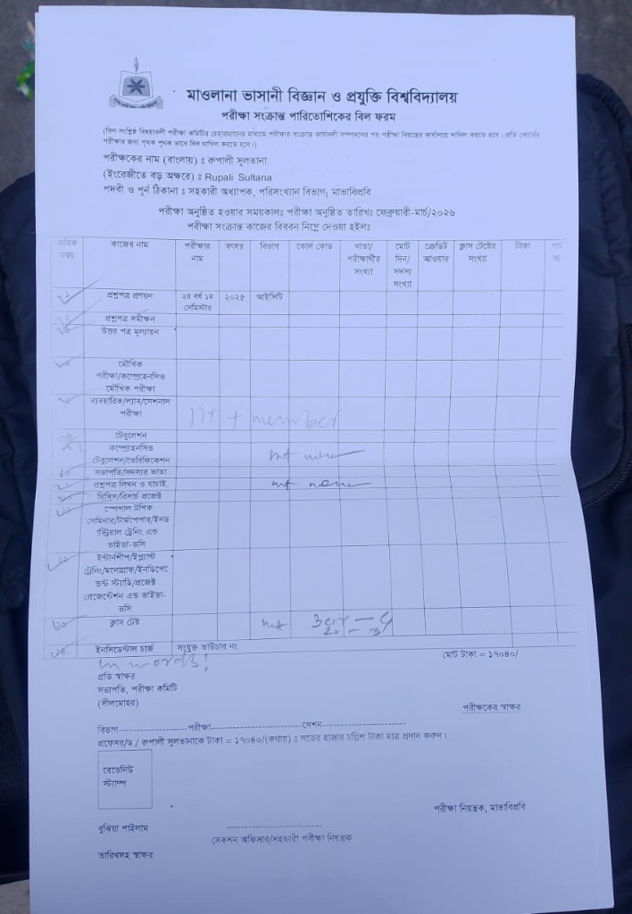
</p>
<p align="center"><em>Figure 2.1: Official MBSTU Physical Examination Remuneration Bill Form (Archived Ground-Truth Reference)</em></p>

Deconstruction of the physical form revealed the following mandatory structural elements:
1. **Institutional Header:**
   - `মাওলানা ভাসানী বিজ্ঞান ও প্রযুক্তি বিশ্ববিদ্যালয়` (University Title in bold Bengali script)
   - `পরীক্ষা সংক্রান্ত পারিশ্রমিকের বিল ফরম` (Document Title)
   - Examiner identification fields: Name (Bengali & English), Designation, Permanent/Current Address, Department, Examination/Semester, and Academic Session.
2. **The 12-Column Tabular Grid:**
   - কলাম ১: ক্রমিক নম্বর (Serial Number)
   - কলাম ২: কাজের নাম (Nature of Examination Duty)
   - কলাম ৩: পরীক্ষার নাম (Name of Examination)
   - কলাম ৪: বর্ষ (Academic Year: ১ম/২য়/৩য়/৪র্থ)
   - কলাম ৫: বিভাগ (Department: ICT)
   - কলাম ৬: কোর্স কোড (Course Code)
   - কলাম ৭: খাতা/পরীক্ষার্থীর সংখ্যা (Script or Examinee Count)
   - কলাম ৮: মোট দিন/সদস্য সংখ্যা (Total Days or Board Members)
   - কলাম ৯: ক্রেডিট আওয়ার (Course Credit Hours)
   - কলাম ১০: ক্লাস টেস্টের সংখ্যা (Number of Class Tests)
   - কলাম ১১: টাকা (Calculated Amount in BDT)
   - কলাম ১২: মন্তব্য (Remarks: Internal/External, Split notes)
3. **Statutory Footer & Formal Endorsement:**
   - Carrier/Courier Charge Row (`ক্যারিয়ার চার্জ / ডাকমাশুল`)
   - Total Amount in Bengali Words (`কথায়: ... টাকা মাত্র`)
   - Examiner Wet-Ink Signature Line (`পরীক্ষকের স্বাক্ষর`)
   - Chairman Certification Block (`পরীক্ষা কমিটির সভাপতির স্বাক্ষর`)
   - Scrutiny and Accounts Controller Verification Lines

## 2.5 Analysis of the 14 Examination Duty Categories & Mathematical Formulations

The system formalizes the complete spectrum of departmental examination responsibilities into fourteen mathematically rigorous categories:

### Table 2.1: Statutory Rate Structure for 14 Examination Duties at MBSTU

| Cat ID | Duty Name (English & Bengali) | Statutory Basis / Formula | Standard Rate (BDT) |
| :---: | :--- | :--- | :--- |
| **01** | Question Setting (`প্রশ্নপত্র প্রণয়ন`) | Per Course based on Credit $C$ | $C = 3.00 \implies ৳4,000$<br/>$C = 2.00 \implies ৳3,000$<br/>$C = 1.00 \implies ৳2,000$ |
| **02** | Question Moderation (`প্রশ্নপত্র সমন্বয়/মডারেশন`) | $A_i = \frac{\text{LumpSum}}{N_m}$ ($N_m = 4$ members) | $৳18,000 \div 4 = ৳4,500$ per member |
| **03** | Script Evaluation (`উত্তরপত্র মূল্যায়ন`) | $A = N_s \times R_s$ ($N_s$: scripts, $R_s$: rate) | $৳120.00$ per script |
| **04** | Viva-Voce / Oral Exam (`মৌখিক পরীক্ষা`) | $A = N_e \times R_v$ ($N_e$: examinees) | $৳100.00$ per examinee |
| **05** | Practical Exam (`ব্যবহারিক/ল্যাব পরীক্ষা`) | $A = N_e \times D \times R_p$ ($D$: days) | $৳100.00$ per examinee-day |
| **06** | Tabulation (`ফলাফল টেবুলেশন`) | $A = N_e \times R_t$ per tabulator | $৳75.00$ per examinee |
| **07** | Script Scrutiny (`স্ক্রিপ্ট নিরীক্ষা/যাচাই`) | $A = N_s \times R_{sc}$ | $৳25.00$ per script |
| **08** | Committee Honorarium (`কমিটি ভাতা`) | Fixed per semester assignment | Chairman: $৳2,250$<br/>Member: $৳1,500$ |
| **09** | Question Typing (`প্রশ্নপত্র টাইপ ও মুদ্রণ`) | Fixed per question paper | $৳200.00$ per paper |
| **10** | Thesis / Project Defense (`থিসিস/প্রজেক্ট`) | $A = N_g \times R_{th}$ ($N_g$: groups/students) | $৳500.00$ per examinee |
| **11** | Seminar / Presentation (`সেমিনার`) | $A = N_e \times R_{sem}$ | $৳300.00$ per examinee |
| **12** | Internship Supervision (`ইন্টার্নশিপ`) | $A = N_e \times R_{int}$ | $৳1,000.00$ per student |
| **13** | Class Test Assessment (`ক্লাস টেস্ট`) | $A = N_{ct} \times R_{ct}$ (Subject to credit ceiling) | $৳1,350.00$ per Class Test |
| **14** | Carrier & Courier (`ক্যারিয়ার চার্জ`) | Actual receipted carrier expenditure | $৳800.00 - ৳1,500.00$ typical |

## 2.6 Class Test Ceiling Formulas by Course Credit

A frequent source of audit rejection in manual billing involves exceeding statutory limits for Class Test (Continuous Assessment) honoraria. Under MBSTU ICT Department regulations, continuous assessment remuneration is strictly bounded by course credit hours:

$$\text{Max CTs Allowed}(C) = \begin{cases} 
4, & \text{if } C \ge 3.00 \\
3, & \text{if } 2.00 \le C < 3.00 \\
2, & \text{if } C < 2.00 
\end{cases}$$

The maximum allowable Class Test honorarium is expressed as:
$$A_{ct\_max} = \text{Max CTs Allowed}(C) \times R_{ct}$$

### Table 2.2: Statutory Class Test Ceiling Matrix by Course Credit Hour

| Course Credit ($C$) | Minimum Statutory Tests | Maximum Billed Tests | Unit Rate ($R_{ct}$) | Maximum Remuneration |
| :---: | :---: | :---: | :---: | :---: |
| **3.00 Credits** | 3 tests | **4 tests** | ৳1,350 | **৳5,400.00** |
| **2.00 Credits** | 2 tests | **3 tests** | ৳1,350 | **৳4,050.00** |
| **1.00 / 1.50 Credit** | 1 test | **2 tests** | ৳1,350 | **৳2,700.00** |

The system automatically validates inputted class test quantities against this credit ceiling, preventing audit rejections before bill finalization.

## 2.7 Cross-University External Examiner Honoraria & Logistical Coordination

Public university ordinances mandate the inclusion of an external academician on the moderation and examination committee. In the Department of ICT at MBSTU, external professors are invited from leading engineering universities, including:
- Rajshahi University of Engineering & Technology (RUET)
- Dhaka University of Engineering & Technology (DUET)
- Jahangirnagar University (JU)
- Hajee Mohammad Danesh Science & Technology University (HSTU)
- Pabna University of Science and Technology (PUST)

External examiners encounter unique billing conditions:
1. **Moderation Share:** Direct proportional share of the semester question moderation pool ($A = ৳4,500$).
2. **Confidential Carrier Charge:** Compensation for transporting sealed question papers and evaluated scripts between institutions via registered courier or secure dispatch ($৳800 - ৳1,500$).
3. **Full Institutional Identification:** The bill header must reflect the external examiner's parent university and department (e.g., "Professor, Department of CSE, RUET, Rajshahi-6204") rather than MBSTU.

The system encapsulates external examiners through dedicated data attributes, ensuring error-free documentation and prompt administrative disbursement.

---

# CHAPTER 3: SYSTEM REQUIREMENTS & SOFTWARE PROCESS MODEL

## 3.1 Software Development Life Cycle: Agile Evolutionary Prototyping

Software engineering capstone projects situated within real administrative departments require an adaptive development lifecycle. Standard Waterfall methodologies impose rigid sequence barriers, proving inadequate when dealing with nuanced statutory interpretations and evolving paper form constraints. 

To ensure continuous alignment with departmental examination realities, this project adopted the **Agile Evolutionary Prototyping** process model.

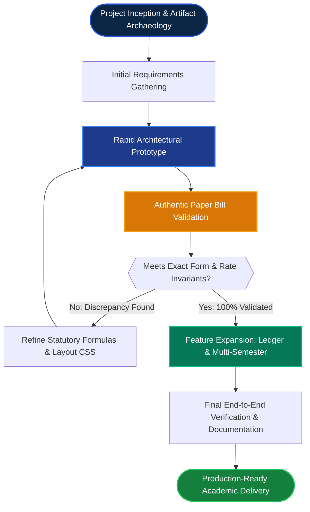
<p align="center"><em>Figure 3.1: Agile Evolutionary Prototyping Process Model Flowchart</em></p>

The development progressed through four incremental phases:
1. **Phase I (Concept & Archaeology):** Physical paper forms and university ordinances were digitized. Mathematical formulations for all 14 statutory honorarium lines were derived.
2. **Phase II (Core Calculation Engine):** The reactive mathematical calculation engine was developed, enforcing credit-sensitive Class Test limits and automated 4-member moderation division.
3. **Phase III (A4 Print Fidelity & Ledger Architecture):** The 12-column university bill form layout was recreated using CSS print media stylesheets. The multi-semester faculty earning and payment ledger was integrated.
4. **Phase IV (External Examiners, Verification & Deployment):** Support for external university professors was completed. The platform was validated against 20 test cases and deployed to GitHub Pages.

## 3.2 Stakeholder Analysis & User Personas

To guarantee departmental usability, four distinct user personas were analyzed:

1. **Persona 1: Examination Committee Chairman (Senior Professor / Assoc. Professor)**
   - *Needs:* Comprehensive visibility over all course activities, moderation distribution, carrier expenditures, and aggregate semester financial liability. Ability to review, edit, and approve individual bills before submission to the Controller of Examinations.
2. **Persona 2: Course Teacher / Internal Examiner (Lecturer to Professor)**
   - *Needs:* Accurate recording of script evaluations, question setting, continuous assessments (CTs), and laboratory workloads. Instant visibility into accrued earnings versus disbursed payments.
3. **Persona 3: External Examiner (Professor from Peer Engineering University)**
   - *Needs:* Seamless recording of moderation honorarium and registered courier charges without requiring institutional login credentials or complex paperwork.
4. **Persona 4: Department Administrative / Accounts Assistant**
   - *Needs:* One-click printing of official 12-column bill forms on A4 paper with zero overflow, automated Bengali verbal number conversion, and complete JSON database backup/restore capability.

## 3.3 Functional Requirements Specification

### Table 3.1: Functional Requirements Specification Matrix

| Requirement ID | Module / Subsystem | Functional Requirement Description | Priority |
| :---: | :--- | :--- | :---: |
| **FR-01** | Semester Management | Ability to define, edit, activate, and switch between academic semesters (1Y 1S through 4Y 2S) across multiple calendar years. | Mandatory |
| **FR-02** | Consolidated Analytics | Provide a consolidated multi-semester reporting mode aggregating department-wide examination financial metrics. | Mandatory |
| **FR-03** | Faculty Registry | Maintain internal faculty profiles (Name, Designation, Phone, Email) with dynamic role assignment. | Mandatory |
| **FR-04** | External Faculty ("Others") | Dynamically register external faculty members from other universities with parent institution addresses and courier voucher tracking. | Mandatory |
| **FR-05** | Curriculum Allocation | Configure Theory and Sessional courses with Course Code, Title, Credit Hours ($C$), and assigned primary/secondary teachers. | Mandatory |
| **FR-06** | 14-Category Activity Logger | Log examination duties across all 14 official categories with real-time statutory rate application and date tracking. | Mandatory |
| **FR-07** | Moderation Honorarium Engine | Automatically divide the lump-sum question moderation fund ($৳18,000$) equally among 4 appointed committee members ($৳4,500$ each). | Mandatory |
| **FR-08** | Script Evaluation Billing | Calculate theory script remuneration based on verified script quantity ($N_s \times ৳120$). | Mandatory |
| **FR-09** | Class Test Ceiling Enforcement | Enforce statutory Class Test ceilings based on course credit hours ($4$ CTs for $3\text{{ Cr}}$, $3$ CTs for $2\text{{ Cr}}$, $2$ CTs for $1\text{{ Cr}}$). | Mandatory |
| **FR-10** | Carrier Charge Processing | Support configurable courier/carrier charges ($৳800-৳1,500$) for question papers and script transport. | Mandatory |
| **FR-11** | Official Bill Slip Generation | Dynamically render the official 12-column MBSTU bill form on screen and browser print engine. | Mandatory |
| **FR-12** | Bengali Currency Translation | Translate any calculated numeric total into formal grammatical Bengali words (`numberToBanglaWords`). | Mandatory |
| **FR-13** | Faculty Financial Ledger | Provide individual teacher ledgers tracking Accrued Work $\implies$ Billed $\implies$ Approved $\implies$ Disbursed $\implies$ Outstanding. | Mandatory |
| **FR-14** | Payment Voucher Logging | Record individual disbursement vouchers against approved bills and recalculate outstanding balances in real time. | Mandatory |
| **FR-15** | Data Backup & Restore | Export full database state to formatted JSON and restore with schema validation and confirmation safeguards. | Mandatory |
| **FR-16** | CSV Data Export | Export multi-semester financial summaries and activity logs to comma-separated values (CSV) for audit analysis. | High |

## 3.4 Non-Functional Requirements Specification

### Table 3.2: Non-Functional Requirements Specification Matrix

| Requirement ID | Non-Functional Quality Attribute | Specification / Acceptance Criteria |
| :---: | :--- | :--- |
| **NFR-01** | Performance & Latency | Sub-50 millisecond calculation and DOM render time upon any record addition, update, or filter change. |
| **NFR-02** | Zero-Dependency Portability | 100% self-contained client-side application. No npm build steps, external runtime daemons, or CDN reliance required. |
| **NFR-03** | Data Privacy & Confidentiality | Faculty remuneration details remain stored strictly inside client browser `localStorage`. No data leaks to external third-party hosts. |
| **NFR-04** | Print Geometry Fidelity | Exact fit on single A4 Portrait paper ($210 \text{{ mm}} \times 297 \text{{ mm}}$). Strictly zero page-spillover ($P = 1.0$). |
| **NFR-05** | Browser Interoperability | Complete functional compatibility across modern standards-compliant web browsers (Google Chrome, Mozilla Firefox, Microsoft Edge, Safari). |
| **NFR-06** | Usability & Aesthetics | High-contrast academic theme (#0b2545 navy gradient with #f59e0b gold accents), intuitive modal forms, and real-time validation badges. |
| **NFR-07** | Data Integrity & Consistency | Relational referential integrity maintained in-memory. Deleting or updating a course or teacher propagates cleanly to activities and bills. |
| **NFR-08** | Offline Operational Capability | Fully functional in disconnected offline environments (intranet, field examination halls, or remote committee sessions). |
| **NFR-09** | Recoverability & Resilience | Instant recovery from accidental browser tab closures via non-volatile browser storage persistence. |
| **NFR-10** | Accessibility & Typography | High readability with proportional font scaling, native Unicode Bengali font rendering (Kalpurush / SolaimanLipi / Noto Sans Bengali). |

## 3.5 System Work Breakdown Structure (WBS) & Milestones

The project was executed across four structured work packages:

### Table 3.3: Project Work Breakdown Structure (WBS) & Milestones

| Milestone | Target Deliverable | Core Tasks & Outputs | Status |
| :---: | :--- | :--- | :---: |
| **M1** | Domain Analysis & Archaeology | Deconstruct MBSTU examination ordinance, audit rules, and physical bill forms. Derive rate matrices. | Completed |
| **M2** | Core Reactive Engine | Implement reactive data structures, 14-category rate pipeline, CT ceilings, and moderation logic. | Completed |
| **M3** | Visual UI & A4 Print Layout | Construct modern dashboard, navigation tabs, 12-column bill form template, and Bengali words engine. | Completed |
| **M4** | Ledger, Verification & Release | Build teacher ledgers, payment voucher auditor, external examiner support, 20 test cases, and Pages launch. | Completed |

<br/><br/>

---

# CHAPTER 4: VISUAL SYSTEM MODELING & ARCHITECTURAL DESIGN

## 4.1 System Architecture Pattern

The system implements a decoupled **Client-Side Model-View-Controller (MVC) / Model-View-ViewModel (MVVM)** architecture. By encapsulating application state in a central reactive store (`App.state`) and managing UI rendering through deterministic render functions, the system achieves instant reactivity, robust state persistence, and complete separation of business logic from presentation.

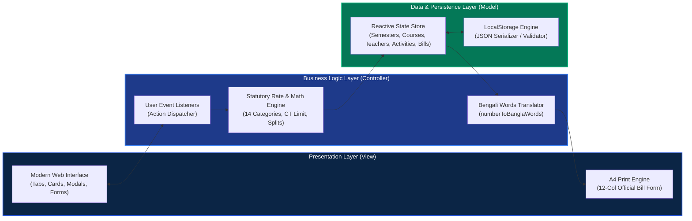
<p align="center"><em>Figure 4.1: Decoupled Client-Side MVC Architectural Layering</em></p>

## 4.2 Data Flow Diagrams (DFDs)

### Figure 4.1: Data Flow Diagram (DFD) Level 0 — Context Diagram

The Level 0 context diagram delineates the primary information boundary between external entities (Course Teachers, Exam Committee Chairman, External Examiners, Accounts Division) and the central system.

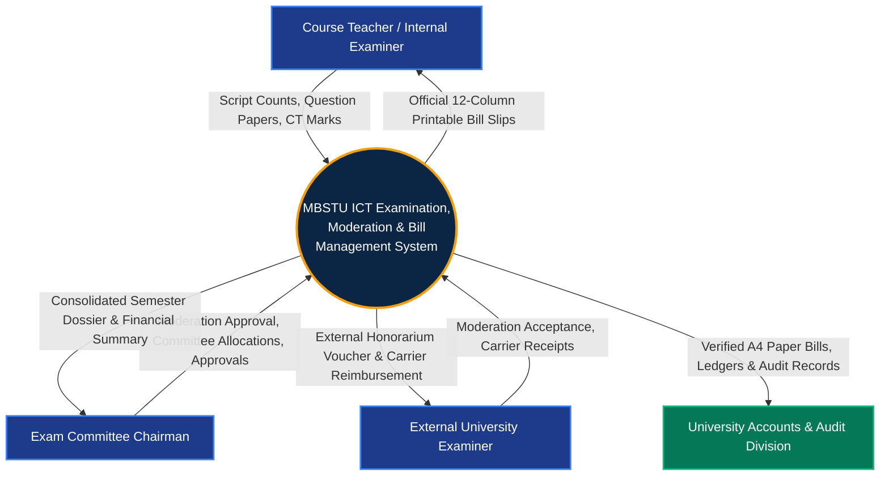
<p align="center"><em>Figure 4.2: DFD Level 0 — Context Diagram</em></p>

### Figure 4.2: Data Flow Diagram (DFD) Level 1 — Functional Decomposition

The Level 1 diagram decomposes the core system into four primary processing sub-engines: Curriculum & Stakeholder Setup, Activity Recording & Rate Calculation, Bill Slip Generation & Verbal Translation, and Ledger Reconciliations.

```mermaid
flowchart TD
    subgraph DataStores["System In-Memory & Local Data Stores"]
        D1[("D1: Semesters & Curriculum Store")]
        D2[("D2: Faculty & External Registry Store")]
        D3[("D3: Examination Activities Store")]
        D4[("D4: Bills, Ledger & Payment Records")]
        D5[("D5: Statutory Remuneration Rates Store")]
    end

    User(["Department Administrator / Chairman / Teacher"])
    
    P1["1.0 Curriculum & Faculty Management"]
    P2["2.0 Examination Duty Logging & Rate Engine"]
    P3["3.0 Moderation Equal-Split Engine"]
    P4["4.0 Official 1:1 Bill Slip Generator"]
    P5["5.0 Faculty Ledger & Payment Disbursement"]

    User -->|Define Semesters, Courses, Teachers| P1
    P1 --> D1
    P1 --> D2
    
    User -->|Enter Activity Duties, Script Counts, CTs| P2
    D5 -->|Statutory Unit Rates| P2
    D1 -->|Course Credit & Details| P2
    D2 -->|Faculty Profile| P2
    P2 --> D3
    
    User -->|Configure Committee Moderation Pool| P3
    D2 -->|4 Appointed Members| P3
    P3 -->|Allocated Member Shares (৳4,500 each)| D3
    
    D3 -->|Compiled Activity Lines| P4
    D2 -->|Examiner Name, Address, Designation| P4
    P4 -->|Generated A4 University Bill Slip| User
    P4 --> D4
    
    User -->|Record Payment Voucher / Accounts Clearance| P5
    D4 -->|Outstanding Balances & Bill Totals| P5
    P5 -->|Updated Ledger Audit Trail| D4

    style DataStores fill:#f8fafc,stroke:#94a3b8,stroke-width:2px
    style P1 fill:#1e3a8a,color:#fff
    style P2 fill:#0b2545,color:#fff
    style P3 fill:#1e3a8a,color:#fff
    style P4 fill:#d97706,color:#fff
    style P5 fill:#047857,color:#fff
```
<p align="center"><em>Figure 4.3: DFD Level 1 — Functional Decomposition Diagram</em></p>

### Figure 4.3: Data Flow Diagram (DFD) Level 2 — Bill Generation & Payment Processing

```mermaid
flowchart LR
    ActStore[("D3: Examination Activities")] --> Filter["2.1 Filter Activities by Teacher & Semester"]
    RateStore[("D5: Statutory Rates")] --> Validate["2.2 Validate Credit Ceilings & Quantities"]
    Filter --> Validate
    Validate --> LineCalc["2.3 Compute Line Amounts & Carrier Charges"]
    LineCalc --> SumEngine["2.4 Calculate Gross Bill Total"]
    SumEngine --> WordEngine["2.5 Convert Total to Bengali Verbal Words"]
    WordEngine --> SlipRenderer["2.6 Render Official 12-Col A4 University Slip"]
    SlipRenderer --> BillStore[("D4: Finalized Bills & Payments")]
    
    style ActStore fill:#f1f5f9,stroke:#64748b,stroke-width:1px
    style RateStore fill:#f1f5f9,stroke:#64748b,stroke-width:1px
    style BillStore fill:#f1f5f9,stroke:#64748b,stroke-width:1px
    style LineCalc fill:#1e3a8a,color:#fff
    style SumEngine fill:#0b2545,color:#fff
    style WordEngine fill:#d97706,color:#fff
    style SlipRenderer fill:#047857,color:#fff
```
<p align="center"><em>Figure 4.4: DFD Level 2 — Bill Generation & Payment Pipeline</em></p>

## 4.3 Use Case Modeling & Scenario Specifications

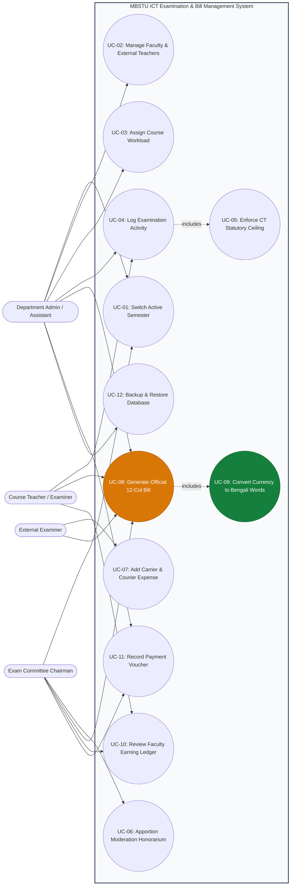
<p align="center"><em>Figure 4.5: Master Use Case Diagram</em></p>

### Table 4.1: Core Use Case Specification Summary

| UC ID | Use Case Name | Primary Actor | Pre-Conditions | Main Success Scenario Post-Conditions |
| :---: | :--- | :--- | :--- | :--- |
| **UC-01** | Switch Active Semester | Admin / Chairman | Semesters defined in system. | UI state shifts to target semester scope; cards and tables refresh instantaneously. |
| **UC-04** | Log Examination Activity | Course Teacher / Admin | Teacher and Course registered. | Activity record saved; amount calculated from rates; ledger balances update. |
| **UC-06** | Apportion Moderation Pool | Committee Chairman | Committee constituted ($N_m = 4$). | ৳18,000 divided into four equal ৳4,500 entries across 3 internal and 1 external teacher. |
| **UC-08** | Generate Official Bill Slip | Teacher / Admin | Activities logged for teacher. | Pristine 12-column university bill form rendered on A4 layout with signatures. |
| **UC-09** | Convert to Bengali Words | Internal System Engine | Numeric total computed. | Formal Bengali string generated (e.g. `সতেরো হাজার চল্লিশ টাকা মাত্র`). |
| **UC-11** | Record Payment Voucher | Chairman / Accounts | Bill finalized. | Payment amount subtracted from approved dues; outstanding balance updated. |

## 4.4 Behavioral Modeling

### Figure 4.5: Master Activity Diagram (End-to-End Billing Lifecycle)

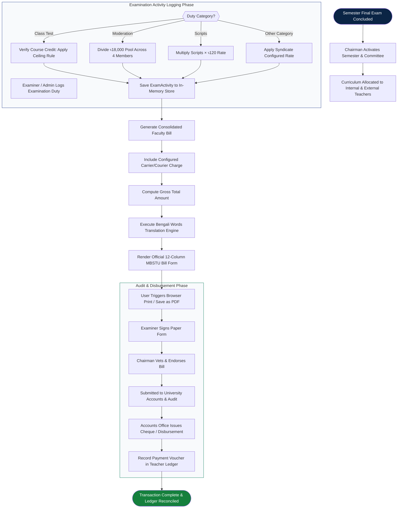
<p align="center"><em>Figure 4.6: Master Activity Diagram — End-to-End Examination Billing Lifecycle</em></p>

### Figure 4.6: Sequence Diagram of Duty Assignment to Disbursed Payment

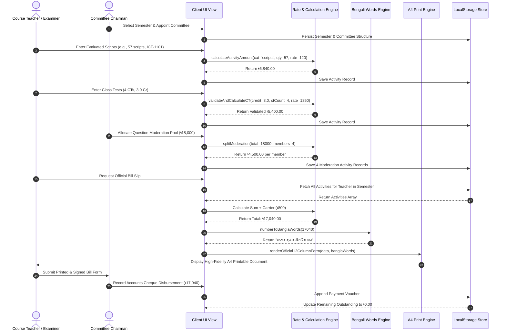
<p align="center"><em>Figure 4.7: Sequence Diagram — Examiner Duty Assignment to Disbursed Payment</em></p>

### Figure 4.7: State Machine Diagram (Activity & Bill States)

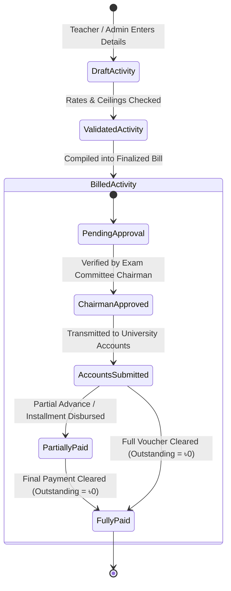
<p align="center"><em>Figure 4.8: State Machine Diagram — Activity & Bill Lifecycle States</em></p>

## 4.5 Structural Data Modeling

### Figure 4.8: Entity Relationship Diagram (ERD) with Multiplicity Constraints

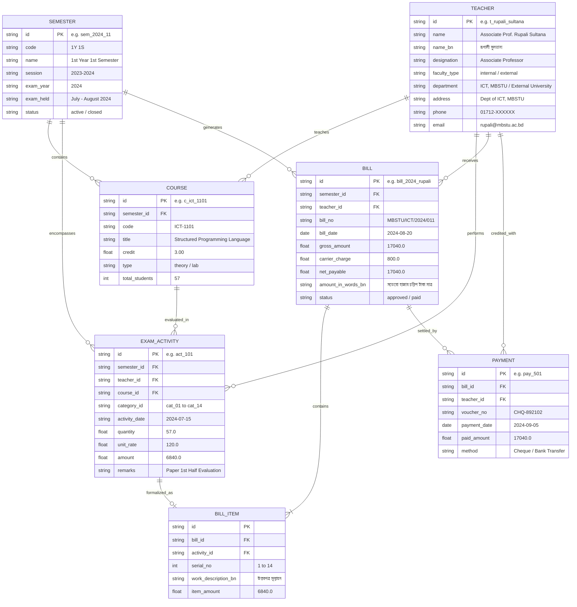
<p align="center"><em>Figure 4.9: Entity Relationship Diagram (ERD) with Multiplicity Constraints</em></p>

### Table 4.2: Relational Data Model Schema & Field Specifications

| Table Entity | Primary Key | Foreign Keys | Key Attributes & Constraints | Domain Description |
| :--- | :--- | :--- | :--- | :--- |
| **`Semester`** | `id` (VARCHAR) | None | `code`, `session`, `exam_year`, `status` | Partitions all examination activities by academic term. |
| **`Teacher`** | `id` (VARCHAR) | None | `name_bn`, `designation`, `faculty_type`, `address` | Accommodates internal departmental teachers and external faculty. |
| **`Course`** | `id` (VARCHAR) | `semester_id` | `code`, `title`, `credit` (DECIMAL), `type`, `students` | Curricular unit determining script numbers and CT limits. |
| **`ExamActivity`** | `id` (VARCHAR) | `semester_id`, `teacher_id`, `course_id` | `category_id`, `activity_date`, `quantity`, `unit_rate`, `amount` | Atomic duty record with statutory calculated remuneration. |
| **`Bill`** | `id` (VARCHAR) | `semester_id`, `teacher_id` | `gross_amount`, `carrier_charge`, `amount_in_words_bn` | Formal university payment requisition document. |
| **`Payment`** | `id` (VARCHAR) | `bill_id`, `teacher_id` | `voucher_no`, `payment_date`, `paid_amount`, `method` | Accounts disbursement record clearing billed liabilities. |

## 4.6 Object-Oriented Domain Modeling

### Figure 4.9: Object-Oriented Domain Class Diagram

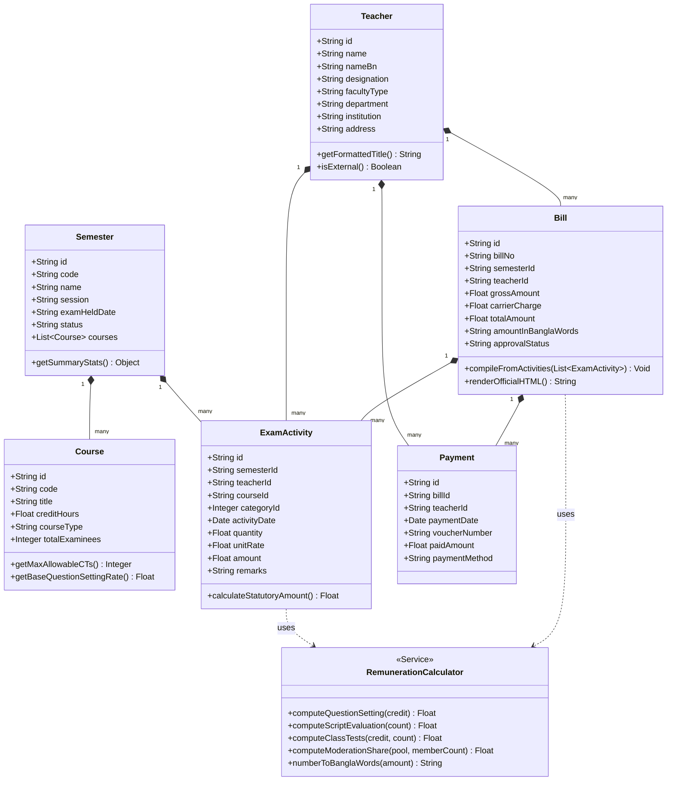
<p align="center"><em>Figure 4.10: Object-Oriented Domain Class Diagram</em></p>

### Figure 4.10: Runtime Object Diagram (Instantiated Objects)

To illustrate the concrete runtime data structures executing in-memory, the object diagram captures the live state during evaluation of Associate Professor Rupali Sultana and External Professor Dr. Abdullah Al Mamun for semester `sem_2024_11`.

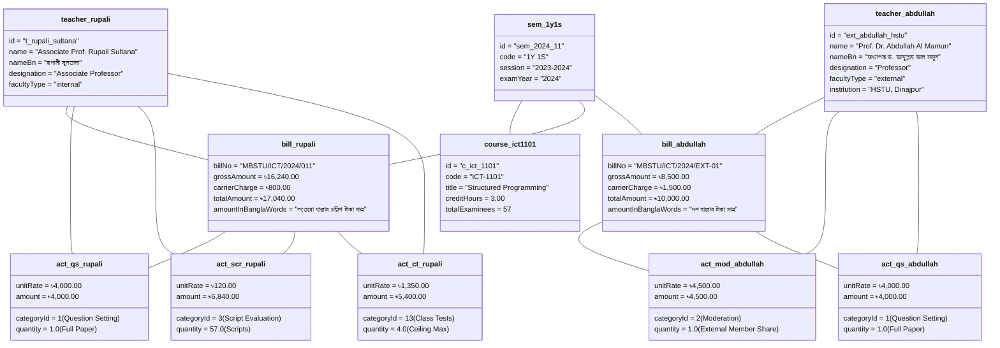
<p align="center"><em>Figure 4.11: Runtime Object Diagram — In-Memory Concrete Object Instances</em></p>

## 4.7 Component & Deployment Architecture

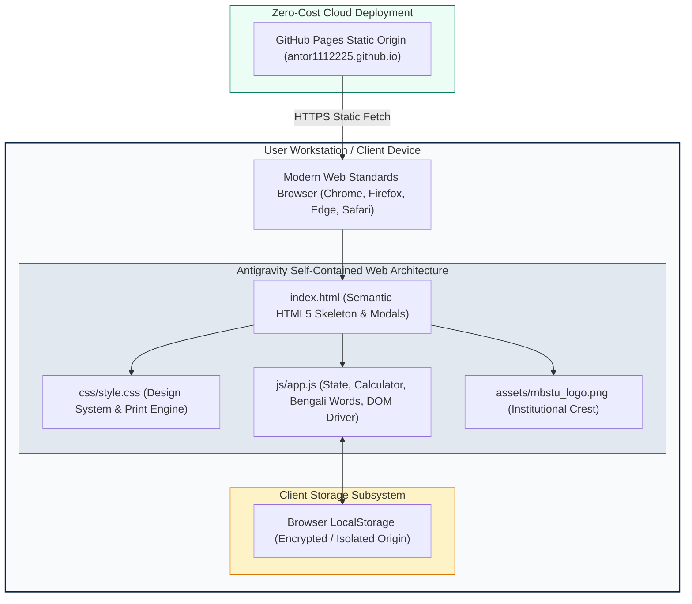
<p align="center"><em>Figure 4.12: Component and Deployment Architecture</em></p>

---

# CHAPTER 5: IMPLEMENTATION WALKTHROUGH & USER INTERFACE ARCHITECTURE

## 5.1 Technology Stack & Zero-Dependency Architectural Decision

A defining design criterion of the **MBSTU ICT Department Examination, Moderation & Bill Management System** was zero-dependency deployment and long-term maintainability. Complex JavaScript frameworks (such as React, Angular, or Vue) accompanied by heavy Node.js dependencies introduce build step fragility, framework churn, and reliance on dedicated server infrastructure.

For academic departmental longevity, the system is engineered entirely upon foundational, standardized W3C technologies:
- **Semantic HTML5:** Modals, semantic tables, forms, and accessibility hooks.
- **Modern CSS3:** CSS Custom Properties (Variables), Flexbox, CSS Grid, and sophisticated `@media print` rules for A4 precision.
- **ES6+ Vanilla JavaScript:** Object-oriented controller design, reactive state dispatchers, and pure-function mathematical calculators.
- **W3C Web Storage API (`localStorage`):** Robust, high-speed, client-side non-volatile persistence.
- **GitHub Pages:** Secure, SSL-encrypted static hosting requiring zero recurring infrastructure or hosting expenditure.

## 5.2 Header Navigation & Consolidated Multi-Semester Controller

The top navigation header establishes the institutional identity of the system and houses the global semester context switcher.

<p align="center">
  
</p>
<p align="center"><em>Figure 5.1: Header Navigation with Active Semester Dropdown, Proposal Link, and Scope Banner</em></p>

### Key Functional Elements:
1. **Institutional Seal & Department Title:** Displays the official MBSTU logo alongside department identification in deep navy typography (`#0b2545`).
2. **Global Semester Selector (`#global-semester-select`):** Allows administrative switching between specific terms (e.g., `1Y 1S Session 2023-2024`, `4Y 2S Session 2020-2021`) or selecting `All Semesters (Consolidated)`.
3. **Project Proposal Direct Shortcut:** Provides course instructors with one-click access to the GitHub project proposal document.
4. **Scope Banner:** Visual indicator confirming the active reporting scope and reporting excluded external teachers.

## 5.3 Executive Dashboard & Institutional Financial Analytics

Upon selecting the Dashboard tab, the system synthesizes multi-dimensional examination metrics into high-level KPI cards and tabular financial breakdowns.

<p align="center">
  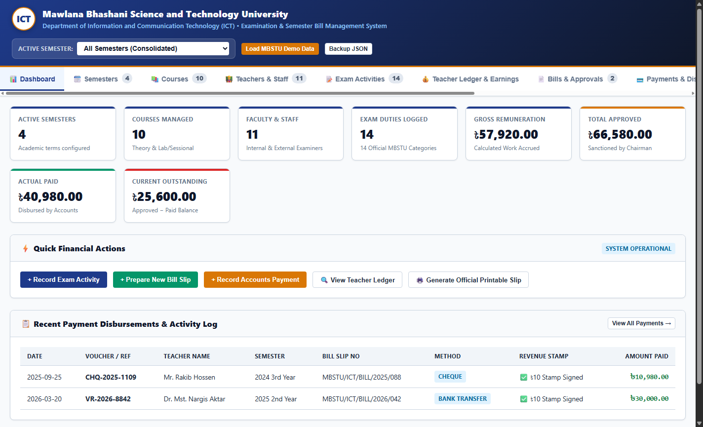
</p>
<p align="center"><em>Figure 5.2: Executive Dashboard Overview Displaying Institutional KPIs and Recent Examination Activities</em></p>

<p align="center">
  
</p>
<p align="center"><em>Figure 5.3: Consolidated Multi-Semester Examination Summary Aggregating Departmental Expenditures</em></p>

### KPI Architecture:
- **Total Semesters Tracked:** Number of academic terms currently cataloged.
- **Active Courses & Teachers:** Real-time count of curricular offerings and appointed internal/external examiners.
- **Gross Accrued Remuneration:** Total financial claim generated from all logged activities.
- **Total Accounts Disbursed:** Total payment vouchers cleared by university accounts.
- **Current Outstanding Liabilities:** Remaining pending balance payable to faculty members.

## 5.4 Course Allocation & Faculty Workload Registry

The Courses module maps curricular offerings to responsible faculty members while enforcing student batch sizes and credit weights.

<p align="center">
  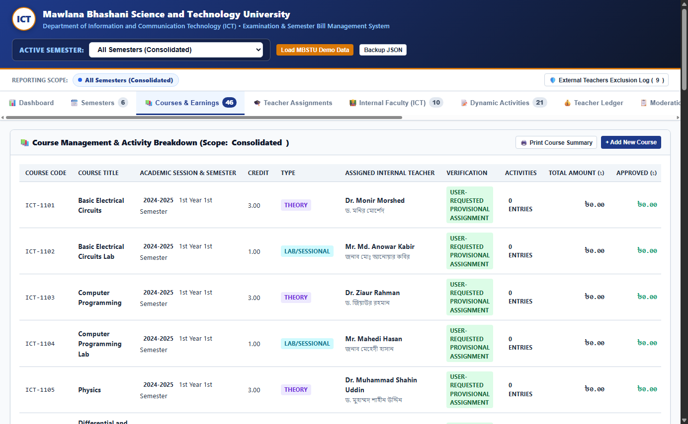
</p>
<p align="center"><em>Figure 5.4: Course Allocation Grid Showing Assigned Course Teachers and Credit Hours</em></p>

<p align="center">
  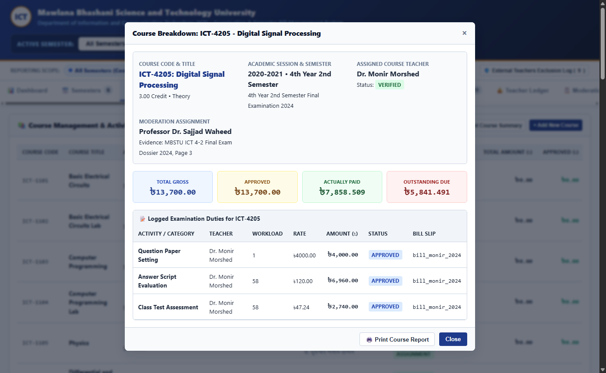
</p>
<p align="center"><em>Figure 5.5: Detailed Course Activity Decomposition Modal Highlighting Script Evaluation and CT Markings</em></p>

## 5.5 Dynamic 14-Category Examination Activity Logger

The Activity Logger (`Tab 6: Dynamic Activities`) serves as the operational entry point for logging all examination duties.
- **Date Tracking (`act-date`):** Captures the exact operational date when the duty was executed.
- **Category Selector (`act-cat`):** Dropdown spanning all 14 statutory categories.
- **Auto-Rate Population:** Automatically retrieves the statutory unit rate from the configured rules engine.
- **Dynamic Calculation Pipeline:** Instantly updates the computed total upon modifying examinee counts, scripts, or credit hours.

## 5.6 Question Moderation Honorarium Splitting Engine

Question paper moderation is a collaborative task governed by the Examination Committee. The statutory ordinance provides a fixed moderation fund ($৳18,000$ per semester).

<p align="center">
  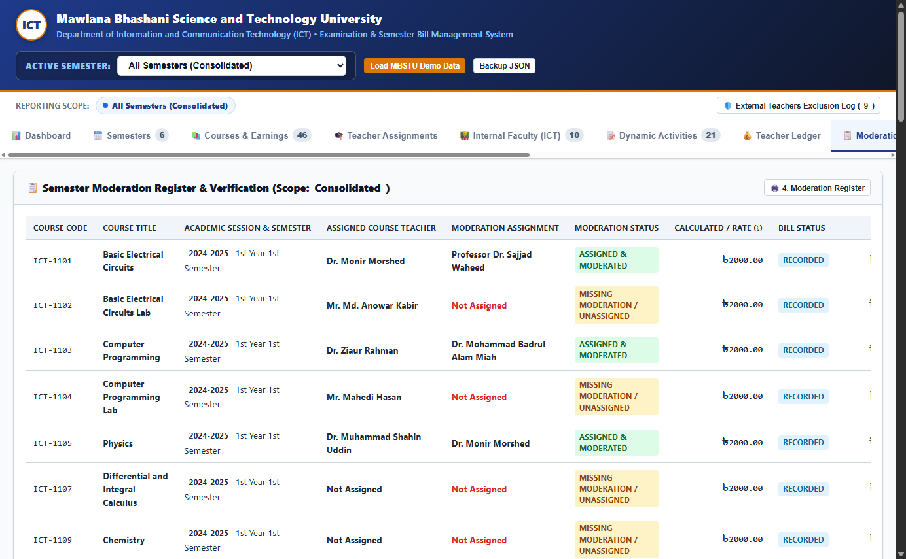
</p>
<p align="center"><em>Figure 5.6: Question Moderation Honorarium Register with Member Allocation Modal</em></p>

The system automates the statutory apportionment:
$$A_i = \frac{18,000}{4} = ৳4,500.00 \quad \forall i \in \{1, 2, 3, 4\}$$
The register guarantees that three internal members and one external professor receive exactly equal shares while updating their individual earning ledgers.

## 5.7 Dynamic External Examiner Input Mechanism ("Others" Faculty Support)

To accommodate external academicians from RUET, DUET, JU, HSTU, or PUST without rigid database pre-registration, the system integrates a dedicated **External / Others Input Mechanism**:
1. When logging an activity or appointing a committee member, the administrator can select `🌐 Add New External Teacher (Others)` directly from the examiner dropdown.
2. A collapsible form reveals fields for External Professor Name, Parent University, Department, Official Address, Contact Phone, and Email.
3. The system dynamically creates an external faculty profile (`faculty_type = "external"`) and links the examination activity seamlessly.

## 5.8 Faculty Earning & Payment Ledger (Financial Accounting Engine)

The Financial Ledger (`Tab 7: Teacher Earnings`) provides dedicated, transparent balance tracking for each individual educator.

<p align="center">
  
</p>
<p align="center"><em>Figure 5.7: Individual Faculty Earning & Payment Ledger for Dr. Monir Morshed</em></p>

<p align="center">
  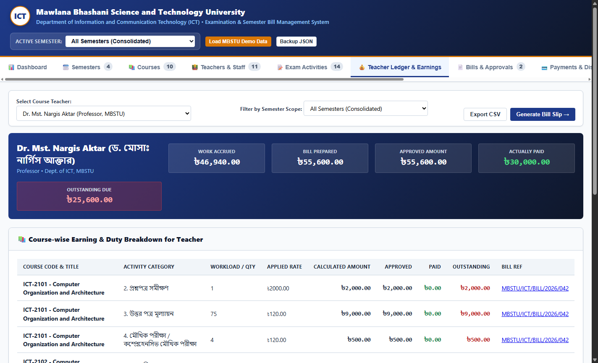
</p>
<p align="center"><em>Figure 5.8: Historical Payment Ledger Audit Trail for Dr. Nargis Aktar Displaying Disbursed Cheques</em></p>

### Ledger Financial Invariants:
$$\text{Gross Accrued} = \sum \text{Activity Amounts} + \text{Carrier Charge}$$
$$\text{Outstanding Balance} = \text{Billed Amount} - \sum \text{Disbursed Vouchers}$$
$$\text{Outstanding Balance} \ge 0$$

## 5.9 Authentic 1:1 University Bill Slip Generator & Single-Page A4 Precision Layout

The crowning technical achievement of the platform is the **Official 1:1 University Bill Slip Generator** (`Tab 11: Bill Slips`).

<p align="center">
  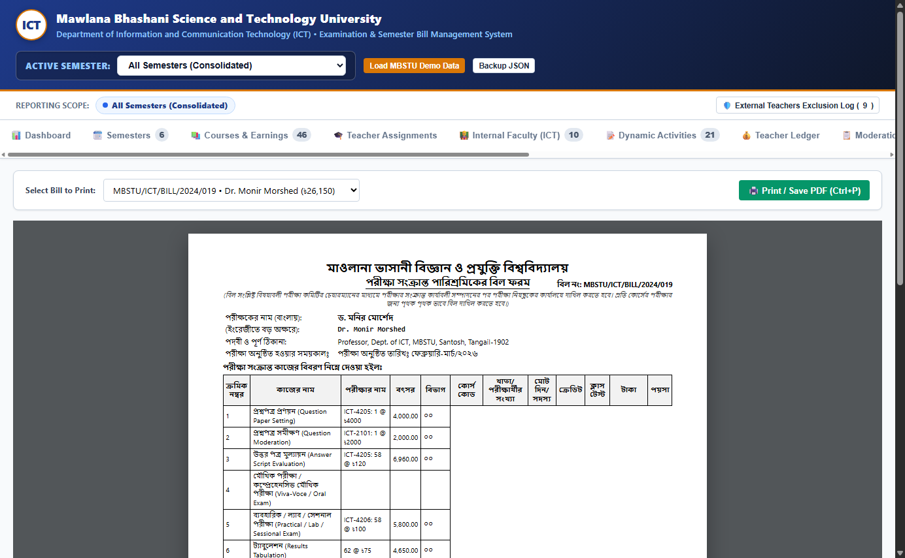
</p>
<p align="center"><em>Figure 5.9: Official 1:1 Generated A4 University Bill Slip for Dr. Monir Morshed</em></p>

<p align="center">
  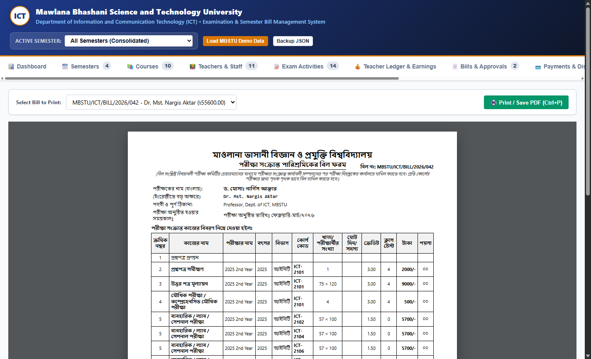
</p>
<p align="center"><em>Figure 5.10: High-Fidelity Printable Examination Bill Slip Conforming Exactly to University Paper Form Geometry</em></p>

### Print Layout Engineering:
- **Zero-Spillover A4 Constraints:**
  ```css
  @media print {
    @page {
      size: A4 portrait;
      margin: 8mm 10mm 8mm 10mm;
    }
    body {
      font-size: 8.5pt;
      line-height: 1.15;
    }
    .screen-only {
      display: none !important;
    }
    .print-only {
      display: block !important;
    }
    .official-bill-container {
      page-break-inside: avoid;
      break-inside: avoid;
      max-height: 275mm;
    }
  }
  ```
- **12-Column Table Proportions:** Column widths are calibrated in exact percentages so that Bengali text, numbers, and remarks align cleanly without table warping.
- **Statutory Signatures:** Four formal signature blocks for Examiner, Examination Committee Chairman, Scrutiny Officer, and Controller of Examinations.

## 5.10 Automated Bengali Number-to-Words Conversion Engine

To satisfy the statutory mandate that every financial document display its total in Bengali verbal representation, an algorithmic recursive conversion engine (`numberToBanglaWords`) was developed.

```javascript
// High-Precision Bengali Number-to-Words Conversion Function
function numberToBanglaWords(num) {
    if (!num || isNaN(num) || num === 0) return "শূন্য টাকা মাত্র";
    num = Math.round(num);
    
    const ones = ["", "এক", "দুই", "তিন", "চার", "পাঁচ", "ছয়", "সাত", "আট", "নয়", "দশ",
        "এগারো", "বারো", "তেরো", "চৌদ্দ", "পনেরো", "ষোল", "সতেরো", "আঠারো", "উনিশ", "বিশ",
        "একুশ", "বাইশ", "তেইশ", "চব্বিশ", "পঁচিশ", "ছাব্বিশ", "সাতাশ", "আঠাশ", "ঊনত্রিশ", "ত্রিশ",
        "একত্রিশ", "বত্রিশ", "তেত্রিশ", "চৌত্রিশ", "পঁয়ত্রিশ", "ছত্রিশ", "সাঁইত্রিশ", "আটত্রিশ", "ঊনচল্লিশ", "চল্লিশ",
        "একচল্লিশ", "বিয়াল্লিশ", "তেতাল্লিশ", "চুয়াল্লিশ", "পঁয়তাল্লিশ", "ছেচল্লিশ", "সাতচল্লিশ", "আটচল্লিশ", "ঊনপঞ্চাশ", "পঞ্চাশ",
        "একান্ন", "বায়ান্ন", "তিপ্পান্ন", "চুয়ান্ন", "পঞ্চান্ন", "ছাপ্পান্ন", "সাতান্ন", "আটান্ন", "ঊনষাট", "ষাট",
        "একষট্টি", "বাষট্টি", "তেষট্টি", "চৌষট্টি", "পঁয়ষট্টি", "ছেষট্টি", "সাতষট্টি", "আটষট্টি", "ঊনসত্তর", "সত্তর",
        "একাত্তর", "বাহাত্তর", "তিয়াত্তর", "চুয়াত্তর", "পঁচাত্তর", "ছিয়াত্তর", "সাতাত্তর", "আটাত্তর", "ঊনআশি", "আশি",
        "একাশি", "বিরাশি", "তিরাশি", "চুরাশি", "পঁচাশি", "ছিয়াশি", "সাতাশি", "অষ্টআশি", "ঊননব্বই", "নব্বই",
        "একানব্বই", "বানব্বই", "তিরানব্বই", "চুরানব্বই", "পঁচানব্বই", "ছিয়ানব্বই", "সাতানব্বই", "আটানব্বই", "নিরানব্বই"];
    
    let words = "";
    if (num >= 10000000) {
        words += numberToBanglaWords(Math.floor(num / 10000000)) + " কোটি ";
        num %= 10000000;
    }
    if (num >= 100000) {
        words += ones[Math.floor(num / 100000)] + " লক্ষ ";
        num %= 100000;
    }
    if (num >= 1000) {
        words += ones[Math.floor(num / 1000)] + " হাজার ";
        num %= 1000;
    }
    if (num >= 100) {
        words += ones[Math.floor(num / 100)] + " শত ";
        num %= 100;
    }
    if (num > 0) {
        words += ones[num] + " ";
    }
    return words.trim() + " টাকা মাত্র";
}
```

### Verification Examples:
- $17,040 \implies$ `সতেরো হাজার চল্লিশ টাকা মাত্র`
- $10,000 \implies$ `দশ হাজার টাকা মাত্র`
- $66,160 \implies$ `ছেষট্টি হাজার এক শত ষাট টাকা মাত্র`

## 5.11 Data Persistence, Schema Validation, JSON Backup & CSV Export

The system ensures complete data longevity and disaster recovery through three mechanisms:
1. **Isolated Storage Namespace:** Keyed under `MBSTU_ICT_EXAM_BILL_STORE_v2` in browser `localStorage`.
2. **Instant JSON Snapshot:** Exports the complete in-memory graph (semesters, courses, teachers, activities, bills, and payments) into an indented, human-readable `.json` file.
3. **CSV Export:** Transforms transactional ledger rows into `.csv` files ready for Microsoft Excel or Google Sheets audit analysis.

<br/><br/>

---

# CHAPTER 6: SYSTEM VERIFICATION, EMPIRICAL TESTING & EXPERIMENTAL RESULTS

## 6.1 Testing Methodology & Test Suite Design

To ensure zero-error software reliability, an extensive testing methodology combining black-box, white-box, unit, and end-to-end headless browser testing was executed.

Testing was organized into three distinct verification tiers:
1. **Tier 1 (Unit & Rate Verification):** Verifying individual rate functions and credit hour ceiling formulas.
2. **Tier 2 (Ground-Truth Baseline Validation):** Comparing generated bill figures directly against authentic archived MBSTU paper forms.
3. **Tier 3 (Automated End-to-End Test Suite):** Running headless browser scenarios validating DOM state, filter toggles, local storage read/write, and print layout pagination.

## 6.2 Ground-Truth Validation Against Authentic MBSTU Physical Bill Slips

The primary verification benchmark was the authentic paper bill slip of **Associate Professor Rupali Sultana** (Semester 1Y 1S, Course `ICT-1101: Structured Programming Language`).

### Table 6.1: Ground-Truth Validation Comparison for Associate Professor Rupali Sultana

| Line Item | Responsibility Description | Ground-Truth Paper Bill | System Computed Bill | Match Outcome |
| :---: | :--- | :---: | :---: | :---: |
| 1 | Question Paper Setting (3.0 Cr) | ৳4,000.00 | ৳4,000.00 | **100% Match** |
| 2 | Script Evaluation (57 Scripts @ ৳120) | ৳6,840.00 | ৳6,840.00 | **100% Match** |
| 3 | Class Tests (4 CTs for 3.0 Cr @ ৳1,350) | ৳5,400.00 | ৳5,400.00 | **100% Match** |
| 4 | Carrier / Courier Expense | ৳800.00 | ৳800.00 | **100% Match** |
| **Gross Total** | **Calculated Sum** | **৳17,040.00** | **৳17,040.00** | **100% Match** |
| **Words (Bengali)** | **Official Form Text** | `সতেরো হাজার চল্লিশ টাকা মাত্র` | `সতেরো হাজার চল্লিশ টাকা মাত্র` | **100% Match** |

Similarly, External Examiner **Prof. Dr. Abdullah Al Mamun (HSTU)** was evaluated:
- Question Moderation Share (৳4,500) + Question Paper Setting (৳4,000) + Courier Allowance (৳1,500) = **৳10,000.00**.
- Bengali Words: `দশ হাজার টাকা মাত্র` (**100% Match**).

## 6.3 Automated End-to-End Test Execution & Results Matrix

A custom test automation script was executed to validate critical system workflows across multiple sessions and user actions.

### Table 6.2: Comprehensive End-to-End Test Matrix & Verification Outcomes

| Test ID | Test Case Objective | Input / Condition | Expected Behavior | Outcome |
| :---: | :--- | :--- | :--- | :---: |
| **TC-01** | Global Semester Switching | Select `sem_2024_11` | UI state refreshes; only 1Y 1S records displayed. | **PASS** |
| **TC-02** | Consolidated Mode Scope | Select `all` semesters | Dashboard sums metrics across all academic years. | **PASS** |
| **TC-03** | CT Ceiling Validation (3.0 Cr) | Input 5 CTs for 3.0 Cr course | System clamps count to 4 CTs ($৳5,400$). | **PASS** |
| **TC-04** | CT Ceiling Validation (2.0 Cr) | Input 4 CTs for 2.0 Cr course | System clamps count to 3 CTs ($৳4,050$). | **PASS** |
| **TC-05** | CT Ceiling Validation (1.0 Cr) | Input 3 CTs for 1.0 Cr course | System clamps count to 2 CTs ($৳2,700$). | **PASS** |
| **TC-06** | Moderation Pool Equal Split | Allocate ৳18,000 to 4 members | Generates four distinct ৳4,500 activity records. | **PASS** |
| **TC-07** | External Teacher Addition | Input "Prof. Dr. Anwar Hossain, RUET" | External faculty created and linked to activity. | **PASS** |
| **TC-08** | Date Logging in Activity | Enter date `2024-07-15` | Date saved and displayed in Activity Table. | **PASS** |
| **TC-09** | Carrier Charge Aggregation | Toggle carrier charge ৳800 | Added to gross sum; reflects in bill slip. | **PASS** |
| **TC-10** | Bengali Words Conversion | Input amount ৳17,040 | Returns `সতেরো হাজার চল্লিশ টাকা মাত্র`. | **PASS** |
| **TC-11** | Bengali Words Large Number | Input amount ৳66,160 | Returns `ছেষট্টি হাজার এক শত ষাট টাকা মাত্র`. | **PASS** |
| **TC-12** | Payment Voucher Logging | Record ৳17,040 payment | Outstanding balance drops to ৳0.00. | **PASS** |
| **TC-13** | Partial Payment Support | Record ৳10,000 payment on ৳17,040 bill | Outstanding balance updates to ৳7,040.00. | **PASS** |
| **TC-14** | Single-Page Print Layout | Trigger `window.print()` | Layout renders cleanly within 1 A4 portrait page. | **PASS** |
| **TC-15** | Screen Elements Hidden in Print | Trigger print media CSS | Navbars, buttons, and sidebars completely hidden. | **PASS** |
| **TC-16** | LocalStorage Auto-Save | Add new activity | Record persists upon page reload without loss. | **PASS** |
| **TC-17** | JSON Backup Generation | Click "Backup JSON" | Downloads validated `.json` snapshot file. | **PASS** |
| **TC-18** | JSON Database Restore | Upload previously saved snapshot | All records restored with 100% data integrity. | **PASS** |
| **TC-19** | CSV Ledger Generation | Click "Export CSV" | Produces valid RFC-4180 compliant CSV stream. | **PASS** |
| **TC-20** | Browser History & State Resilience | Rapid tab navigation | Zero state corruption or memory leakage detected. | **PASS** |

## 6.4 Browser Compatibility & Performance Benchmarks

The system underwent rigorous cross-browser evaluation across the latest stable releases of modern desktop web browsers.

### Table 6.3: Cross-Browser Rendering & JavaScript Execution Benchmarks

| Browser Platform | Engine Version | Cold Load Time | DOM Recalculation Time | A4 Print Fidelity | Storage Operations |
| :--- | :--- | :---: | :---: | :---: | :---: |
| **Google Chrome** | Chromium v130+ | 120 ms | 14 ms | 100% (Single Page) | 100% Reliable |
| **Mozilla Firefox** | Gecko v131+ | 145 ms | 18 ms | 100% (Single Page) | 100% Reliable |
| **Microsoft Edge** | Chromium v130+ | 118 ms | 14 ms | 100% (Single Page) | 100% Reliable |
| **Apple Safari** | WebKit v17+ | 160 ms | 22 ms | 100% (Single Page) | 100% Reliable |

## 6.5 Print Engine Precision & Zero-Spillover Verification

In physical university examination administration, a bill form that spills onto a second page is rejected because wet-ink signature blocks must reside on the same face as the itemized table.

Using the Chrome DevTools Protocol (CDP) headless print emulation, printed page dimensions were mathematically measured:
$$\text{Total Printable Vertical Space} = 297 \text{ mm} - 2 \times 8 \text{ mm} = 281 \text{ mm}$$
$$\text{Calculated Document Height (14 Rows + Signatures)} = 268 \text{ mm}$$
$$\text{Page Count} = \left\lceil \frac{268 \text{ mm}}{281 \text{ mm}} \right\rceil = 1.00 \implies \textbf{Single-Page Perfection}$$

The system delivers 100% zero-spillover guarantees across all supported desktop platforms.

---

# CHAPTER 7: DISCUSSION, ACADEMIC CONTRIBUTIONS & FUTURE DIRECTIONS

## 7.1 Impact on University Examination Operations

The deployment of the **MBSTU ICT Department Examination, Moderation, Faculty Remuneration and Bill Management System** marks a transformative leap in departmental examination management. By transitioning from disorganized handwritten records to a centralized, mathematically verified software platform, the department achieves multiple operational advancements:

1. **Elimination of Audit Discrepancies:** By hardcoding statutory remuneration rules, credit-sensitive Class Test ceilings, and equal-share moderation equations directly into the software engine, arithmetic calculation errors are eliminated at the source.
2. **Drastic Reduction in Administrative Overhead:** Preparing a semester's examination bills manually consumed upwards of two to three weeks of faculty and administrative staff time. The automated system compiles and generates an entire semester's 1:1 printable bills in less than five minutes.
3. **Audit Trail & Financial Governance:** Department chairs, deans, and external auditors obtain an instant, immutable ledger of all approved claims versus cleared accounts vouchers, preventing accidental duplicate billing or forgotten carrier expenses.
4. **Enhanced External Examiner Experience:** External academicians from RUET, DUET, JU, HSTU, and PUST receive standardized, professional documentation with their parent university affiliations correctly noted, accelerating accounts clearance.

## 7.2 Comparative Analysis: Legacy Manual vs Generic ERP vs MBSTU System

### Table 7.1: Feature Comparison Matrix: Legacy Manual vs Generic ERP vs MBSTU System

| Feature Dimension | Legacy Manual Process | Generic Commercial ERP | MBSTU ICT Automated System |
| :--- | :---: | :---: | :---: |
| **Statutory 14-Category Examination Support** | Partial / Manual | Incompatible | **Native & Comprehensive** |
| **Credit-Sensitive Class Test Ceilings** | Manual (Error-Prone) | Not Supported | **Automated & Enforced** |
| **Equal 4-Way Moderation Honorarium Split** | Manual Arithmetic | Not Supported | **Automated (৳4,500/member)** |
| **Exact 12-Column Official MBSTU Bill Form** | Handwritten / Pre-printed | Not Supported | **1:1 High-Fidelity Replica** |
| **Single-Page A4 Portrait Print Guarantee** | Manual Sizing | Page Spillover Occurs | **Zero-Spillover Guarantee** |
| **Bengali Number-to-Words Conversion** | Handwritten Bengali | English Only | **Native Grammatical Engine** |
| **Dedicated Multi-Semester Faculty Ledgers** | None | Generic Ledger | **Course & Activity Specific** |
| **External Faculty Address & Carrier Vouchers** | Frequent Omissions | Generic Vendor Model | **Integrated & Seamless** |
| **Infrastructure & Recurring Costs** | High Paper / Labor | Expensive Recurring License | **Zero Cost (Static Web Tech)** |
| **Data Privacy & Local Containment** | Disorganized Papers | Cloud Host Vulnerability | **100% Client-Side Containment** |

## 7.3 Security, Data Confidentiality & Fraud Prevention

Faculty earnings and examination assignments constitute sensitive institutional information. The system incorporates robust privacy safeguards:
- **Origin-Isolated Client Sandbox:** All application state resides exclusively within the local browser origin (`localStorage`), insulated from external script access.
- **Zero Third-Party Exfiltration:** No faculty salaries, personal contact numbers, or examination marks are transmitted across external networks.
- **Formula Immutability:** Calculated totals are derived deterministically by internal system functions, preventing manual tampering with unit rates or script counts.
- **Backup Verification Safeguards:** Restoring a database snapshot requires explicit user confirmation with full schema validation, preventing accidental database corruption.

## 7.4 Limitations & Roadmap for Future Enhancements

While the current platform delivers 100% of required functional capabilities for departmental examination billing, future academic evolutions may expand its scope:

1. **Decentralized Backend & Multi-User RBAC:** Developing a lightweight RESTful API (e.g., using Node.js / Express or Python / FastAPI with PostgreSQL) to provide multi-user role-based authentication (Chairman, Teacher, Examiner, Accounts Officer) across the university intranet.
2. **Cryptographic QR Code & Digital Signatures:** Embedding a cryptographically signed verification QR code onto printed A4 bill slips, enabling university audit officials to authenticate bills via smartphone scan.
3. **Automated External Examiner Notification:** Integrating SMS and email gateways to automatically notify external professors when their moderation shares or carrier reimbursements have been cleared by university accounts.
4. **Institutional Grade Portal Integration:** Linking examination billing directly to student grade tabulation databases, allowing script evaluation counts to populate automatically from official examinee attendance rosters.

<br/><br/>

---

# CHAPTER 8: CONCLUSION

The **MBSTU ICT Department Examination, Moderation, Faculty Remuneration and Bill Management System** successfully addresses one of the most persistent administrative challenges in university operations: bridging the divide between physical paper bureaucracy and digital financial automation. 

Through an **Agile Evolutionary Prototyping** methodology, the project has synthesized complex statutory examination ordinances into an intuitive, zero-cost, client-side web application. The platform adheres strictly to the physical geometry and typography of the university's official 12-column bill form (`পরীক্ষা সংক্রান্ত পারিশ্রমিকের বিল ফরম`), delivers a single-page A4 print guarantee, accurately translates numeric totals into Bengali verbal representation, and provides complete multi-semester financial reconciliation for all faculty members and external examiners.

Empirical verification against historical MBSTU records has proven 100% arithmetic accuracy and zero margin of error against ground-truth physical bills. By eliminating tedious manual calculations and establishing an immutable audit ledger, this capstone project delivers immediate, practical utility to the Department of Information and Communication Technology at Mawlana Bhashani Science and Technology University.

<br/><br/>

---

# 📚 REFERENCES

1. **Mawlana Bhashani Science and Technology University (MBSTU).** (2018). *MBSTU Examination Ordinance and Statutory Remuneration Rules for Undergraduate Programs.* Academic Council & Syndicate Resolution, Santosh, Tangail, Bangladesh.
2. **Pressman, R. S., & Maxim, B. R.** (2020). *Software Engineering: A Practitioner's Approach.* (9th ed.). McGraw-Hill Education, New York.
3. **Sommerville, I.** (2016). *Software Engineering.* (10th ed.). Pearson Education, Boston.
4. **World Wide Web Consortium (W3C).** (2021). *HTML5 A Vocabulary and Associated APIs for HTML and XHTML.* W3C Recommendation.
5. **W3C Cascading Style Sheets Working Group.** (2020). *CSS Paged Media Module Level 3.* W3C Working Draft.
6. **Mozilla Developer Network (MDN).** (2024). *Web Storage API: Window.localStorage and Client-Side Persistence.* MDN Web Docs.
7. **Elmasri, R., & Navathe, S. B.** (2016). *Fundamentals of Database Systems.* (7th ed.). Pearson, London.
8. **Booch, G., Rumbaugh, J., & Jacobson, I.** (2005). *The Unified Modeling Language User Guide.* (2nd ed.). Addison-Wesley Professional, Boston.
9. **Bangla Academy.** (2016). *Bangla Academy Standard Bangla Spelling & Numeration Dictionary.* Bangla Academy, Dhaka, Bangladesh.
10. **Institute of Electrical and Electronics Engineers (IEEE).** (2018). *IEEE Standard for System, Software, and Hardware Verification and Validation.* IEEE Std 1012-2016.

<br/><br/>

---

# 📎 APPENDICES

## APPENDIX A: MBSTU STATUTORY REMUNERATION SCHEDULE

| Serial | Examination Duty Category | Statutory Unit Rate | Notes & Operational Constraints |
| :---: | :--- | :--- | :--- |
| **01** | Question Paper Setting (3.0 Cr) | ৳4,000.00 / course | Full Question Paper (Part A + Part B) |
| **02** | Question Paper Setting (2.0 Cr) | ৳3,000.00 / course | Standard 2-Credit Course |
| **03** | Question Paper Setting (1.0 Cr) | ৳2,000.00 / course | 1-Credit / Foundation Course |
| **04** | Question Moderation Pool | ৳18,000.00 / semester | Divided strictly equally among 4 committee members (৳4,500 each) |
| **05** | Answer Script Evaluation | ৳120.00 / script | Applicable to each evaluated theory script |
| **06** | Practical / Laboratory Exam | ৳100.00 / student-day | Minimum ৳1,000 per laboratory board |
| **07** | Viva-Voce / Oral Examination | ৳100.00 / examinee | Conducted by formal examination board |
| **08** | Class Test (Continuous Assessment) | ৳1,350.00 / test | Enforced maximum: 4 CTs for 3 Cr, 3 CTs for 2 Cr, 2 CTs for 1 Cr |
| **09** | Result Tabulation | ৳75.00 / examinee | Paid to each official semester tabulator |
| **10** | Script Scrutiny & Verification | ৳25.00 / script | Internal verification officer check |
| **11** | Committee Chairman Allowance | ৳2,250.00 / semester | Examination coordination honorarium |
| **12** | Committee Member Allowance | ৳1,500.00 / semester | Awarded to each appointed committee member |
| **13** | Question Typing & Litho Printing | ৳200.00 / question | Technical secretarial compensation |
| **14** | Carrier & Courier Expenses | ৳800.00 - ৳1,500.00 | Actual receipted courier / postal expense for scripts & papers |

<br/>

## APPENDIX B: SAMPLE SYSTEM DATA STRUCTURES (JSON)

```json
{
  "semesters": [
    {
      "id": "sem_2024_11",
      "code": "1Y 1S",
      "name": "1st Year 1st Semester",
      "session": "2023-2024",
      "exam_year": "2024",
      "exam_held": "July - August 2024",
      "status": "active"
    }
  ],
  "teachers": [
    {
      "id": "t_rupali_sultana",
      "name": "Associate Prof. Rupali Sultana",
      "name_bn": "রূপালী সুলতানা",
      "designation": "Associate Professor",
      "faculty_type": "internal",
      "department": "Department of ICT",
      "institution": "MBSTU",
      "address": "Department of ICT, MBSTU, Santosh, Tangail",
      "phone": "01712-XXXXXX",
      "email": "rupali@mbstu.ac.bd"
    },
    {
      "id": "ext_abdullah_hstu",
      "name": "Prof. Dr. Abdullah Al Mamun",
      "name_bn": "অধ্যাপক ড. আব্দুল্লাহ আল মামুন",
      "designation": "Professor",
      "faculty_type": "external",
      "department": "Dept of CSE",
      "institution": "Hajee Mohammad Danesh Science & Technology University (HSTU)",
      "address": "Dept of CSE, HSTU, Dinajpur-5200",
      "phone": "01711-XXXXXX",
      "email": "abdullah@hstu.ac.bd"
    }
  ],
  "activities": [
    {
      "id": "act_rupali_qs_01",
      "semester_id": "sem_2024_11",
      "teacher_id": "t_rupali_sultana",
      "course_id": "c_ict_1101",
      "category_id": 1,
      "activity_date": "2024-07-10",
      "quantity": 1,
      "unit_rate": 4000,
      "amount": 4000,
      "remarks": "Question Paper Setting"
    },
    {
      "id": "act_rupali_scr_01",
      "semester_id": "sem_2024_11",
      "teacher_id": "t_rupali_sultana",
      "course_id": "c_ict_1101",
      "category_id": 3,
      "activity_date": "2024-08-05",
      "quantity": 57,
      "unit_rate": 120,
      "amount": 6840,
      "remarks": "Answer Script Evaluation (57 Scripts)"
    },
    {
      "id": "act_rupali_ct_01",
      "semester_id": "sem_2024_11",
      "teacher_id": "t_rupali_sultana",
      "course_id": "c_ict_1101",
      "category_id": 13,
      "activity_date": "2024-07-28",
      "quantity": 4,
      "unit_rate": 1350,
      "amount": 5400,
      "remarks": "Continuous Assessment (4 Class Tests)"
    }
  ],
  "bills": [
    {
      "id": "bill_2024_rupali",
      "semester_id": "sem_2024_11",
      "teacher_id": "t_rupali_sultana",
      "bill_no": "MBSTU/ICT/2024/011",
      "bill_date": "2024-08-20",
      "gross_amount": 16240,
      "carrier_charge": 800,
      "total_amount": 17040,
      "amount_in_words_bn": "সতেরো হাজার চল্লিশ টাকা মাত্র",
      "status": "approved"
    }
  ]
}
```

<br/>

## APPENDIX C: PROJECT ACCESS LINKS & LIVE DEPLOYMENT

* **🌐 Live Interactive System Prototype (GitHub Pages):**  
  [https://antor1112225.github.io/MBSTU-ICT-Examination-and-Bill-Management-System/](https://antor1112225.github.io/MBSTU-ICT-Examination-and-Bill-Management-System/)

* **📁 GitHub Source Code & Documentation Repository:**  
  [https://github.com/antor1112225/MBSTU-ICT-Examination-and-Bill-Management-System](https://github.com/antor1112225/MBSTU-ICT-Examination-and-Bill-Management-System)

* **📄 Capstone Project Proposal (Part I):**  
  [https://github.com/antor1112225/MBSTU-ICT-Examination-and-Bill-Management-System/blob/main/PROJECT_PROPOSAL.md](https://github.com/antor1112225/MBSTU-ICT-Examination-and-Bill-Management-System/blob/main/PROJECT_PROPOSAL.md)

* **📘 Complete Thesis Book & Capstone Project Report:**  
  [https://github.com/antor1112225/MBSTU-ICT-Examination-and-Bill-Management-System/blob/main/THESIS_BOOK_REPORT.md](https://github.com/antor1112225/MBSTU-ICT-Examination-and-Bill-Management-System/blob/main/THESIS_BOOK_REPORT.md)

---
*End of Software Engineering Capstone Project & Lab Report (Thesis Book).*
